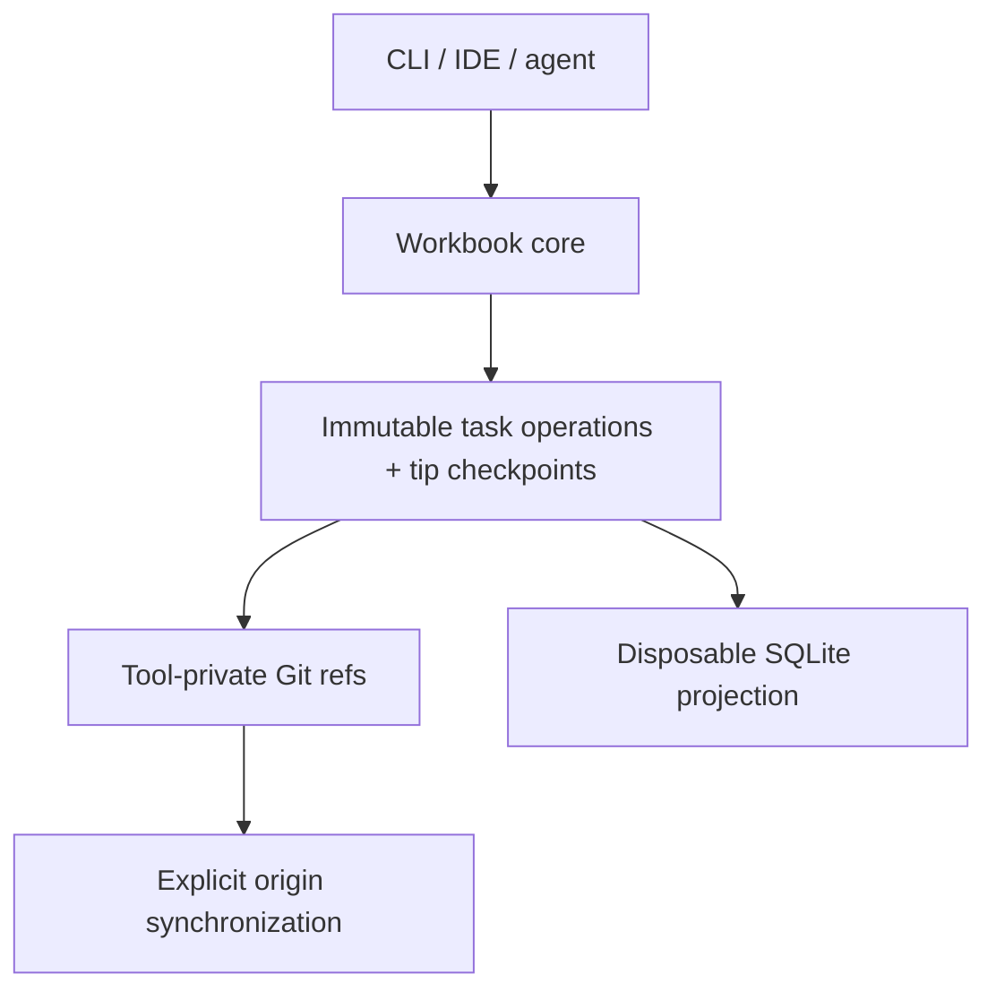

# Workbook architecture

How Workbook stores tasks in Git, keeps replicas synchronized, and projects
state into SQLite. For the command surface, see
[reference.md](reference.md).


Workbook separates its data model, transport, and query engine:



| Layer | Responsibility |
| --- | --- |
| Operation model | Defines task history, current tip checkpoints, causality, and validation |
| Git refs and objects | Store task operations durably and explicitly synchronize task refs with `origin` |
| SQLite projection | Materializes current task state and recorded operations for local reads; Git remains canonical |
| CLI/core library | Currently owns initialization, local validation, CRUD, and user-facing output |
| Optional adapters (proposed) | IDE integrations, local API, MCP, or a coordination relay |

Workbook adds only tracked bootstrap configuration to the working tree. Task state
does not live on the currently checked-out code branch.

## Git storage model

Each task owns a custom Git ref:

```text
refs/workbook/tasks/TASK-123
refs/workbook/tasks/TASK-456
```

The ref points to a Git **commit object**. That commit is the current head of the task's operation DAG:

```text
ref
 └── commit
      ├── parent commit(s)
      └── tree
           ├── operation.json blob
           ├── state.json blob
           └── attachment-<ULID> blob   (only on a commit that attached a file)
```

- A task's root commit has no parents and holds `task.create`, or
  `history.checkpoint` once the task is compacted (see [Compaction](#compaction)).
- A normal edit commit has one parent.
- A future reconciliation or resolution commit can have multiple parents.
- Immutable `operation.json` packs are the authoritative record of task intent,
  and Git parent ancestry is the authoritative record of causality.
- Every commit tree contains the edit's versioned operation pack in
  `operation.json` and a deterministic, durable task materialization in
  `state.json`. A commit that attached a file also carries that file's bytes as
  a blob named for the attachment, and the checkpoint records the blob's object
  ID so reading an attachment costs one object read rather than a tree walk.
- An attachment's bytes are reachable **only** through their own task's ref
  history. There is no shared attachment store and no cross-task deduplication:
  two tasks attaching identical bytes each carry the blob in their own commit,
  and Git storing one object for both is a property of content addressing rather
  than a dependency between the two histories. `workbook compact` depends on
  this: it can drop one task's attachments by replacing that task's history with
  a checkpoint, without reasoning about any other task.
- Removing an attachment hides it and reclaims nothing. The bytes stay in the
  commit that added them, because no command changes a commit. Space comes back
  only after `workbook compact` moves the task's ref to a checkpoint that does
  not carry the bytes, and Git then prunes the commits that are no longer
  reachable.
- The durable model requires each `state.json` checkpoint to match the result of
  applying that commit's operation pack to its parent state, or to no parent
  state for a root commit.
- Ordinary `list`, `show`, `fetch`, and `sync` validate and use current tip
  checkpoints without replaying the complete history. This bounded default does
  not change the authority of immutable operations or Git ancestry.
- Reading a task's operation history — for the projection's `operations` table
  and for `workbook show --history` — reads the operation packs alone and does
  not revalidate their documents, tree shape, or stored checkpoints. The write
  path already prevents this clone from recording an invalid commit, and setup,
  sync, and fetch validate what arrives from elsewhere, so revalidating a whole
  history on every read buys nothing and makes a read scale with history depth.
  An unreadable commit truncates the read softly: the valid prefix is returned
  and the boundary commit is named.
- `workbook validate` explicitly replays history and reconstructs checkpoints;
  it is not part of ordinary current-tip reads or synchronization, and it
  remains the path that audits stored checkpoints.

Using one ref per task avoids a single global state-branch bottleneck: local
commands working on different tasks update different refs. Future concurrent edits
to the same task can form branches in that task's operation DAG and will require
the proposed domain reconciliation rules.

### Relic refs

A relic is a second kind of record, stored beside tasks and by the same means.
Each relic owns one ref, named by its ID. These are the three relics
[the reference](reference.md#relics) builds, and every example in this
section is from that same repository:

```text
3e680ce8bdf534b0a12ddb4002e693c3894a9369 commit	refs/workbook/relics/WB-R-01M87F0SQYHP3HCR4QEN3RTVEX
00fc4f61eb62c288c79d3c9cef8ba71d3416340a commit	refs/workbook/relics/WB-R-01M87F0YHZ1852KPS55KCDPXG2
a112b0c1b8059dfafa88aefc65ad45d447da7426 commit	refs/workbook/relics/WB-R-01M87F17QTWKQKT6MZWX54HFY8
```

The ref points to a commit, and a relic's history is a chain of them. The
chain's first commit has no parent: it creates the relic or, once the relic is
[compacted](#compacted-relics), is its checkpoint. Every later commit has exactly
one parent, and a relic commit is never a merge. No command changes a relic
commit, and deleting a relic is a tombstone operation that leaves the ref in
place.

Every commit's tree holds the operations the commit records and the whole
relic as they leave it:

```text
operation.json                workbook.relic-operation-pack   the operations this commit records
state.json                    workbook.relic-state            the relic after them, without part content
links.json                    workbook.relic-links            the relic's live links
parts/<part-id>/fields.json   workbook.relic-part-fields      one part's fields
parts/<part-id>/body          raw bytes, exactly as given     one part's body
```

`parts/` is there exactly when the relic has at least one part. It holds one
subtree for each part the state lists, live or removed, named by the part's
ID. A subtree always holds `fields.json`, even when the part has no fields,
and holds `body` only when the part has a body. This is the second commit of
the first relic, the one that added its first two parts:

```sh
git cat-file -p 46d0f2366693b7b2c12931251a6f5ccf8baaf254
git ls-tree -r -t 46d0f2366693b7b2c12931251a6f5ccf8baaf254
```

```text
tree aa9cacbfa79f0b0df65954bfe848e2082256d02b
parent 2583738ff456c357a6e355cfdd2100a17ff705ff
author Alice <alice@example.com> 1795546966 -0500
committer Alice <alice@example.com> 1795546966 -0500

update relic WB-R-01M87F0SQYHP3HCR4QEN3RTVEX
100644 blob 6dff43c5f530676ca8e2b2af7abd0a5313114242	links.json
100644 blob e2a8753c19ef8bec82721be1e125d90398e5dfda	operation.json
040000 tree 86cec1d053a9538dd05920695cad813c99fcebc0	parts
040000 tree 2a01530cc10dfba07644e3695b3e2c55e9e66bde	parts/01M87F0T8ZACFWH3F27EK4CYVH
100644 blob 16d81d64d9b6b65c667cb090454484b0f0607e4d	parts/01M87F0T8ZACFWH3F27EK4CYVH/body
100644 blob a6810f4c2c65f39a46e613b576342477923289e3	parts/01M87F0T8ZACFWH3F27EK4CYVH/fields.json
040000 tree 56523e1fc6cd3fce09bd6cde24fe776a124c5a63	parts/01M87F0T8ZDXPZV8WNS006CBKV
100644 blob 434192cf2e5b563c3f91be8b2d479e83a9d2f77c	parts/01M87F0T8ZDXPZV8WNS006CBKV/fields.json
100644 blob 47fe6ed186d6346917b301bf7c2f6ad889888523	state.json
```

**The four documents.** Each names its format and `"version": 1`, and is
stored as one line: the output of Go's `json.Marshal` and one newline, with
the members in the order shown here. A stored document that is not byte for
byte what this build writes for the same content is `corrupt-data`. No relic
document records a Git object ID, so the format is the same in SHA-1 and
SHA-256 repositories. `wallTime`, `createdAt` and `updatedAt` are display
metadata. Workbook writes them in UTC with a `Z`, but a reader accepts any
RFC 3339 offset, so a project or a tool built on Workbook may store them in a
zone of its own. The offset is kept: Go reads such a time and writes it back in
the same bytes, so folding, replay, the index and JSON output all carry it
unchanged, and two clones holding the same commits agree. A zero offset has one
form, `Z`. Go writes `+00:00` and `-00:00` back as `Z`, so a document holding
either is not its own re-encoding, and a reader refuses it as `corrupt-data`.

`operation.json` of that commit, stored as one line and shown here through
`jq .`:

```json
{
  "format": "workbook.relic-operation-pack",
  "version": 1,
  "minReader": 6,
  "projectId": "01M87F0RVXDCDBV34NDN8Z3Y5E",
  "relicId": "WB-R-01M87F0SQYHP3HCR4QEN3RTVEX",
  "historyGeneration": "01M87F0SQY2QS322FBM9041WZG",
  "actor": {
    "id": "alice@example.com"
  },
  "logicalClock": 2,
  "wallTime": "2026-11-24T19:02:46.30335Z",
  "operations": [
    {
      "id": "01M87F0T8ZZF0EYEQ24M0ZWM2Z",
      "type": "property.set",
      "name": "status",
      "value": "draft"
    },
    {
      "id": "01M87F0T8ZACFWH3F27EK4CYVH",
      "type": "part.add",
      "partType": "section",
      "position": "1/1",
      "body": {
        "format": "md",
        "bytes": 102
      }
    },
    {
      "id": "01M87F0T8ZDXPZV8WNS006CBKV",
      "type": "part.add",
      "partType": "decision",
      "position": "2/1"
    }
  ]
}
```

`historyGeneration` is a ULID minted when the relic is created, and every pack
of the relic repeats it. `logicalClock` is `1` in the creating commit and one
more in each commit after it. A later commit saved a new body over the first
part's, and its `operation.json` is, as stored:

```json
{"format":"workbook.relic-operation-pack","version":1,"minReader":6,"projectId":"01M87F0RVXDCDBV34NDN8Z3Y5E","relicId":"WB-R-01M87F0SQYHP3HCR4QEN3RTVEX","historyGeneration":"01M87F0SQY2QS322FBM9041WZG","actor":{"id":"alice@example.com"},"logicalClock":4,"wallTime":"2026-11-24T19:02:51.757371Z","operations":[{"id":"01M87F0ZKD0X1MC06E1JCG5QBY","type":"part.body.set","part":"01M87F0T8ZACFWH3F27EK4CYVH","body":{"format":"md","bytes":146,"base":"01M87F0T8ZACFWH3F27EK4CYVH"}}]}
```

An operation's members are always written in one order, `id`, `type`,
`relic`, `title`, `name`, `value`, `part`, `partType`, `position`, `body`, `link`,
`linkId`, `relicType`, `schema`, `checkpoint`, `merge`, and an operation has only the
ones its type takes:

| Operation type | Members after `id` and `type`, in stored order |
| --- | --- |
| `relic.create` | `relic`: `title`, `type`, `schema` when the relic names a [schema version](#relic-schemas), `createdAt` |
| `title.set` | `title` |
| `relic.tombstone`, `relic.restore`, `relic.retire`, `relic.unretire` | none |
| `property.set` | `name`, `value` |
| `property.clear` | `name` |
| `part.add` | `partType`, `position`, and `body` when the part is added with one: `format` when it has a label, then `bytes`. The operation's `id` is the new part's ID. |
| `part.field.set` | `name`, `value`, `part` |
| `part.field.clear` | `name`, `part` |
| `part.body.set` | `part`, and `body`: `format` when it has a label, then `bytes`, then `base`, the body version the save started from, left out when the part had no body |
| `part.move` | `part`, `position` |
| `part.remove`, `part.restore` | `part` |
| `link.add` | `link`: `from` when the link is from a part, `to` (`{"task": "<task-id>"}`, or `{"relic": "<relic-id>"}` with `part` after `relic` for a link to a part), then `rel`, then `seen` for a link to a relic, then `pointer` when there is one. The operation's `id` is the new link's ID. |
| `link.remove` | `linkId`, the ID of the link it removes |
| `relic.migrate` | `relicType`, then `schema`, the version the relic moves to, left out when it becomes open |
| `history.checkpoint` | `checkpoint`: `runId`, `compactedFrom`, `previousGeneration`, `boundary`, `since`, `compactedCommits`, `firstWallTime`, `lastWallTime`, `compactedOperations` |

An operation that carries any other member, lacks one of its own, or writes
them in another order is `corrupt-data`. A `value` is a JSON value in
canonical form: what `json.Marshal` writes after decoding with numbers kept as
text, so object members are sorted and `<`, `>` and `&` inside a string are
`\u003c`, `\u003e` and `\u0026`. It nests arrays and objects at
most 32 levels deep, and it is at most 65,536 bytes as a property's value and
16,384 bytes as a field's. A `name` is 1 to 100 bytes of valid UTF-8 with no
`=`, no control character (Unicode category Cc), no format character
(category Cf), and no white space (Unicode `White_Space`) at either end. Names are not normalized, and are compared byte
for byte. `part.add` and `part.body.set` carry a body's label and size and
never its content, and a new part's fields are not in the pack either: both
are in the commit's tree. An operation pack therefore does not grow with the
content it records.

`state.json` of the same commit as the first pack, through `jq .`:

```json
{
  "format": "workbook.relic-state",
  "version": 1,
  "minReader": 6,
  "projectId": "01M87F0RVXDCDBV34NDN8Z3Y5E",
  "relicId": "WB-R-01M87F0SQYHP3HCR4QEN3RTVEX",
  "history": {
    "generation": "01M87F0SQY2QS322FBM9041WZG",
    "compactedFrom": null
  },
  "logicalClock": 2,
  "relic": {
    "title": "Task archive compaction",
    "type": "spec",
    "schema": null,
    "author": "alice@example.com",
    "retired": false,
    "deleted": false,
    "createdAt": "2026-11-24T19:02:45.75869Z",
    "updatedAt": "2026-11-24T19:02:46.30335Z",
    "properties": {
      "status": "draft"
    },
    "parts": [
      {
        "id": "01M87F0T8ZACFWH3F27EK4CYVH",
        "type": "section",
        "position": "1/1",
        "body": {
          "format": "md",
          "version": "01M87F0T8ZACFWH3F27EK4CYVH",
          "bytes": 102
        }
      },
      {
        "id": "01M87F0T8ZDXPZV8WNS006CBKV",
        "type": "decision",
        "position": "2/1"
      }
    ]
  }
}
```

`parts` is ordered by position, then by part ID. A part has `removed` only
when it is `true`, and a body has `format` only when it has a label. A body's
`version` is the ID of the operation that saved it: the `part.add` for a
part's first body, which is why it equals the part's ID above, and the
`part.body.set` after that. `author` is the actor of the creating commit, and
`updatedAt` is the `wallTime` of this one. `schema` is `null` for a relic that
names no [schema version](#relic-schemas), and otherwise the version's ID, a
string; `relic.create` sets it and `relic.migrate` sets it with `type`.
`retired` is `true` after a `relic.retire` and `false` again after a
`relic.unretire`. `history.compactedFrom` is `null` until the relic is
[compacted](#compacted-relics).

Compaction adds two members, each written only when present, so a state without
them keeps the bytes it had before they existed:

- `relic.compacted`, after `deleted`: `{"runId", "at", "boundary", "since"}`,
  the run, when it wrote the checkpoint, `retired` or `deleted`, and when the
  relic last became retired or deleted, by boundary. Every state after a
  checkpoint carries it, and it is present exactly when `history.compactedFrom`
  is.
- `dropped`, after `removed` on a part: `{"removedAt", "droppedAt"}`. It marks a
  **stub**, a removed part with no `body` whose content a checkpoint dropped.
  A stub exists only in a compacted relic.

`links.json` holds the relic's live links, ordered by ID, and is these 57
bytes in every commit of a relic that has none:

```json
{"format":"workbook.relic-links","version":1,"links":[]}
```

A link is added by a `link.add` and removed by a `link.remove` that names its
ID, and `links.json` is what folding them gives. A removed link is gone from
`links.json` and lives on only in the history. In the reference's session,
the relic linked to two tasks, and then the link to the first was removed:

```text
refs/workbook/relics/WB-R-01M87F0SQYHP3HCR4QEN3RTVEX ──> C2 (parent C1)
  C2 operation.json  [link.remove linkId 01M87F2KNMJKQA2AYXXF2ZQ5C4]
     links.json      [01M87F2KR522KBJ4CWWSRHRY4G]
  C1 operation.json  [link.add 01M87F2KNMJKQA2AYXXF2ZQ5C4  to WB-01M87F19RB1PVEE87F7PS1D1FJ  implemented-by,
                      link.add 01M87F2KR522KBJ4CWWSRHRY4G  from part 01M87F0T8ZDXPZV8WNS006CBKV
                                                           to WB-01M87F2JJT7ERPBSGFX8XTZ4NW  implemented-by]
     links.json      [01M87F2KNMJKQA2AYXXF2ZQ5C4, 01M87F2KR522KBJ4CWWSRHRY4G]
```

with C2's `links.json`, as stored:

```json
{"format":"workbook.relic-links","version":1,"links":[{"id":"01M87F2KR522KBJ4CWWSRHRY4G","from":"01M87F0T8ZDXPZV8WNS006CBKV","to":{"task":"WB-01M87F2JJT7ERPBSGFX8XTZ4NW"},"rel":"implemented-by"}]}
```

A link has `id`, `from` only when it is from a part, `to`, `rel`, `seen` only
when it points at a relic, and `pointer` only when it has one. `rel` is 1 to
100 bytes of lowercase letters and digits with single hyphens between words.

| Member | Stored form |
| --- | --- |
| `to` | An object with exactly one of `task` (a task ID) or `relic` (`to.relic`, a relic ID), and, only with `relic`, optionally `part` (`to.part`, a part ID). |
| `seen` | Required with `to.relic` and absent otherwise: the ID of the last operation in the target relic's newest change when the link was added, or, for a link to the relic itself, in its newest change before the one that adds the link. |
| `pointer` | Optional on any target: one JSON object in the canonical form of a value (see above), at most 512 bytes in that form, nesting at most 32 levels. A reader refuses one that is not canonical, not an object or too large. |

Any other member is `corrupt-data` on read, and the same checks are made when a
link is saved. A `link.add` is `corrupt-data` when its ID
is already a live link's, a part's or a current body version's, or when its
`from` names a part the relic does not have. A `link.remove` that names no
live link changes nothing: the link was removed in another clone, or the
remove was delivered twice. A link stays when its task is deleted, and a link
from a removed part stays in `links.json`; readers hide it wherever they hide
the part. No task commit records anything about a link.

**Links to relics and parts.** A link is stored once, on the relic it starts
from, and nothing is written on the target, whether it is a task, a relic or a
part: one relic's ref is the only thing a link changes, so adding one never
conflicts with an edit to its target. The decision relic of the
[reference's second session](reference.md#links-to-relics-and-parts) after one
command that added two links:

```text
refs/workbook/relics/WB-R-01M8FNC4Y9… (decisions)  →  commit D3 (parent D2)
  tree: operation.json  [link.add 01M8FNC6ZR… → WB-R-01M8FNC40G…#01M8FNC4E4…,
                         link.add 01M8FNC725… → WB-R-01M8FNC5V9…#01M8FNC69Q…]
        links.json      [01M8FNC6ZR…, 01M8FNC725…]
        state.json      (new logical clock and update time; the parts are unchanged)
        parts/…         (unchanged)
refs/workbook/relics/WB-R-01M8FNC40G… (transcript)  →  unchanged
refs/workbook/relics/WB-R-01M8FNC5V9… (spec)        →  unchanged
```

D3's `links.json`, as stored:

```json
{"format":"workbook.relic-links","version":1,"links":[{"id":"01M8FNC6ZRCDBFDN2Y8MMKD43C","from":"01M8FNC5BNK2SV4A47G38AB5Y2","to":{"relic":"WB-R-01M8FNC40GNSPEJF1YEZQMV7MF","part":"01M8FNC4E4EZFGME2ZNF9NAM80"},"rel":"decided-in","seen":"01M8FNC4E48J13Q44GQD4NR2BD","pointer":{"at":"00:14:32","quote":"by hand"}},{"id":"01M8FNC7256KH6HRKR57JKYA3D","from":"01M8FNC5BNK2SV4A47G38AB5Y2","to":{"relic":"WB-R-01M8FNC5V9NMQTZ105DPV173BC","part":"01M8FNC69QHEMTG2FA0F80KBKR"},"rel":"changes","seen":"01M8FNC69QHEMTG2FA0F80KBKR"}]}
```

The fold and every read treat a target as data they never resolve, so a link to
a relic this clone lacks, to a deleted relic or to a removed part folds like any
other, and so do a link to the relic itself and links that close a cycle. Only
`relic update` checks that a target exists, and a read says how it stands (see
[When a target is removed](reference.md#when-a-target-is-removed)). At most
2,000 live links with 512-byte pointers make `links.json` about 1.7 MiB, under
the 4,194,304-byte limit on one object.

**Concurrent links.** Each `link.add` mints its own ID, so every add either
clone makes survives a replay, and a `link.remove` removes only the ID it
names. These are guarantees. An add in one clone and a removal of an older
link with the same `from`, `to` and `rel` in another leave the new link; two
removals of one link fold to one; two clones adding the same link at once
leave two links with two IDs, both listed, until somebody unlinks one. A
command adding a link that is already live (the same `from`, `to`, `rel` and
pointer bytes) records nothing, so only clones that had not seen each other's add
can make that pair. A link to a relic or part follows the same observed-remove
rules. A link added in one clone and the target part's removal or the target
relic's deletion in another change two different refs, so both apply, and the
link reads as pointing at something removed. A link change stops a
replay only as any edit does: a link added onto a relic the other clone
deleted is a `tombstone` conflict. A link added from a part the other clone removed is
kept with the `relic-edit-on-removed-part` warning, and links that together
pass the 2,000-link limit are kept with `relic-over-limit`.

`parts/<part-id>/fields.json`, for the second part above:

```json
{"format":"workbook.relic-part-fields","version":1,"fields":{"accepted":true,"heading":"Keep a backup bundle"}}
```

**Generations.** A relic pack declares what its operations need, the largest
writer-format generation among them: `relic.retire`, `relic.unretire` and
`history.checkpoint` need generation 7, and the operation types of the first
relic stories need 6; see [Mixed Workbook versions](#mixed-workbook-versions).
A state declares the larger of its parent's and its pack's, so every state after
a retirement or a checkpoint stays at 7 or higher, an `unretire` included. A
relic pack that declares less than its operations need, or a state that is
retired or compacted and declares less than 7, is `corrupt-data`. One that
declares a generation above what this build folds was written by a newer
Workbook: it is read as far as it can be, shown, and neither changed nor judged
by the rules below.

Links to relics and pointers added members at generation 6 without raising it,
because no release that reads relics has shipped; releases from before relics
never fetch relic refs. The cost falls on an unreleased build of this format from
before relic links. It reads a relic holding a link to a relic, or any link with
a pointer, as `corrupt-data`: `relic show` and `relic update` refuse that relic,
`relic list` fails, and `workbook validate` reports it invalid. Its task
commands still run, and `workbook show` warns that it cannot read the relic.
Nothing is lost or rewritten, and a current build reads the relic. A links
document that holds only task links without pointers is byte for byte what such
a build writes.

**The fold.** `state.json` is what folding the commit's operations onto its
parent's state computes. A checkpoint is the exception: it carries no content,
and is judged by the [checkpoint's own rules](#compacted-relics). Some operations fold to no change and stay in the
history: a `part.body.set` whose `base` is not the part's current body
version, an operation that names a part the relic does not have or a stub,
removing a removed part, restoring a live one, retiring a retired relic,
unretiring one that is not, and clearing a name that is not set.
Deletion is stricter, as it is for tasks: `relic.restore` needs a deleted
relic and comes first in its pack, and any other operation on a deleted relic
is `corrupt-data`. The commands are stricter than the fold. `relic update`
refuses a body save from a stale base instead of recording one the fold would
ignore, and refuses a change to a stub, other than removing it again, which
records nothing.

**An operation ID is used once in a relic's history.** A part's ID is the ID
of the `part.add` that made it, and a body's version is the ID of the
operation that saved it, so an ID used twice would name two things. The fold
refuses the reuse the parent's state shows, as `corrupt-data`: a `part.add`
whose ID is the ID of a part the relic already has or the current body version
of one, and a `part.body.set` whose ID is a part's ID. A second `part.add`
for a part is therefore not ignored. Any other reuse leaves no trace in the
state, and only a walk over the whole history sees it.

**What makes a relic commit valid.** For a commit with pack P, its parent
commit (none for the first) and its stored state and links:

1. The stored state and links are what folding P onto the parent's computes,
   byte for byte.
2. The tree holds `operation.json`, `state.json` and `links.json` as regular
   blobs, the tree `parts` exactly when the state lists a part, and nothing
   else. The first commit has no parent and its pack opens with
   `relic.create` or, for a compacted relic, is one `history.checkpoint`; every
   other commit has exactly one parent.
3. `parts/` holds one subtree for each part the state lists, named by part ID.
   Each holds `fields.json`, `body` exactly when the state records a body, and
   nothing else.
4. A `fields.json` is at most 4,194,304 bytes, the limit for any one stored
   object, and each value in it is at most 16,384 bytes. A `body` is at most
   1,048,576 bytes, and is the size the state records.
5. A part that P does not name has the same subtree object as in the parent.
6. A part's `body` differs from the parent's only when this commit saved it:
   the state's body version for the part is the ID of an operation in P, and
   the part is new in this commit or that version is not the one in the
   parent's state. A repeated `part.body.set`, which the fold ignores,
   therefore cannot bring new content with it.
7. A part's `fields.json` is the parent's with P's `part.field.set` and
   `part.field.clear` operations for that part applied in order. For a part P
   adds, it is a canonical fields document that agrees with any field
   operations P carries for it.

A stub's subtree never changes after its checkpoint, named by the pack or not,
so a commit after the checkpoint holds the stub to its parent's subtree and
applies none of P's field operations to it. A checkpoint commit has no parent to
follow from, so rules 1, 5, 6 and 7 give way to the
[checkpoint's own rules](#compacted-relics).

Rules 1 to 6 are judged from object IDs and sizes: the `parts` tree and each
part's subtree are read, but no `fields.json` or `body` blob is opened. The
exception is the limit on one field value, which takes reading the
`fields.json` that holds it. One case of rule 7 is also judged from object IDs:
a part that P names without setting or clearing a field keeps the `fields.json`
object it had. The rest of rule 7 reads the `fields.json` of the parts P names.

No rule limits how large one relic's properties are together, or one part's
fields, or how many parts a relic has. Those are totals. The commands refuse a
change that leaves one over its limit and larger than it was, and nothing
checks one when a relic is read, so a relic over a total still reads. See
[What a relic may hold](reference.md#what-a-relic-may-hold).

- A **write** computes the state by folding and refuses to store a record
  that is not the fold's. A part the pack does not name keeps its subtree
  object, so a commit stores only what it changed.
- **`relic show`, `export`, `update`, `migrate`, `delete`, `restore`, `retire`
  and `unretire`** check the
  relic's newest commit against its parent by rules 1 to 6 and the case of
  rule 7 that needs no read, and check the limit on one field value for the
  parts whose fields they read.
- **`relic list`** reads each relic's newest commit alone: rule 2, and that
  the three documents are the bytes this build writes.
- **`workbook validate`** checks every commit of every relic, first to
  newest, by all seven rules (a checkpoint by its own), and caches nothing. It
  also refuses a relic in which one operation ID is recorded by two commits of
  that relic's own history, or by a later commit and the checkpoint's list. It
  compares nothing across relics.

**Writes are compare-and-swap.** Nothing is visible until the ref moves, and
the ref moves only if it still points at the commit the change started from.
Of two writers that started from the same commit, exactly one lands and the
other is refused as `stale-write`, told that another change was saved first
and to run the command again. Nothing retries it. A write interrupted before
the ref moves leaves unreferenced objects and changes nothing.

**Relic refs are shared with the task refs.** The one `git fetch` of a relic
command, `workbook fetch`, `sync`, `setup` or a watcher's round carries a
fourth refspec beside the task, identity and settings refspecs:

```text
+refs/workbook/relics/*:refs/workbook/remotes/<remote>/relics/*
```

so each relic at the tasks remote lands on a tracking ref under
`refs/workbook/remotes/<remote>/relics/`, written only by `git fetch`, and the
relic's own ref is then moved to it by compare-and-swap. In the second clone of
the reference's session, right after setup, each relic's ref and its tracking
ref name the same commit:

```text
3e680ce8bdf534b0a12ddb4002e693c3894a9369 commit	refs/workbook/relics/WB-R-01M87F0SQYHP3HCR4QEN3RTVEX
00fc4f61eb62c288c79d3c9cef8ba71d3416340a commit	refs/workbook/relics/WB-R-01M87F0YHZ1852KPS55KCDPXG2
a112b0c1b8059dfafa88aefc65ad45d447da7426 commit	refs/workbook/relics/WB-R-01M87F17QTWKQKT6MZWX54HFY8
3e680ce8bdf534b0a12ddb4002e693c3894a9369 commit	refs/workbook/remotes/origin/relics/WB-R-01M87F0SQYHP3HCR4QEN3RTVEX
00fc4f61eb62c288c79d3c9cef8ba71d3416340a commit	refs/workbook/remotes/origin/relics/WB-R-01M87F0YHZ1852KPS55KCDPXG2
a112b0c1b8059dfafa88aefc65ad45d447da7426 commit	refs/workbook/remotes/origin/relics/WB-R-01M87F17QTWKQKT6MZWX54HFY8
```

Relic refs go out in a `git push` of their own, after the task push and only
when a relic changed. It deletes no ref and forces none unconditionally, so a
remote that holds newer commits refuses it, and the next fetch replays this
clone's commits onto them. The one ref it may move other than forward is a
[compacted relic's](#compacted-relics), under a lease. Relic refs move in their own transaction after the task
refs, so a relic can never roll back a task; a sync stopped between the two
leaves the relics one sync behind, which the next sync repairs.

**A task command moves no relic ref.** The synchronization a task command
such as `create`, `update` or `next` runs before and after its change fetches
with the three refspecs a fetch named before relics existed and pushes only
what it changed, so it fetches, replays, parks and pushes no relic, and the
refs Workbook names to Git do not grow with the number of relics. A relic
reaches a checkout with the next relic command that changes a relic, `workbook fetch` or
`workbook sync` there, and `workbook show <task>` lists the linked relics the
checkout holds until then. A task command handed to a watcher waits only for
the watcher to receive the request, never for the round that carries relics.

**Relic refs are packed in the checkout.** A task command names no relic to
Git, but its `git fetch` still reads every ref the checkout holds, and with
the files ref backend Git keeps each new or moved ref as a file of its own
until something packs it. A thousand loose relic refs and their thousand
tracking refs made `workbook next` and `update` measurably slower than with
no relics. So a run that moved a relic ref in this checkout packs Workbook's relic
namespaces, and nothing else, once at its end:

```text
git pack-refs --include refs/workbook/relics/* \
              --include refs/workbook/reconciled-relics/* \
              --include refs/workbook/remotes/<remote>/relics/*
```

The last pattern is given once for each remote whose relics the run fetched,
with that remote's name in it. `pack-refs` matches these patterns without
pathname rules, so a `*` crosses `/`, and one
`refs/workbook/remotes/*/relics/*` would also match a ref such as
`refs/workbook/remotes/origin/tasks/foo/relics/bar`, the mirror of a stray
nested task name at origin. Naming each remote's whole relic tracking prefix
cannot match anything outside it, because a remote name Workbook uses is a
single path component. The tracking refs of a remote this checkout no longer
fetches relics from are not packed.

The runs that can move one are a relic command that changes a relic, `workbook
compact --relics`, `workbook
fetch`, `sync` (one run, and each round of `sync --watch` or the board's
loop), `setup` and `move-tasks`; `push` moves no relic ref in the checkout and
packs nothing. A run that moved no relic ref starts no Git process for it, and
no task command or relic read ever packs. `--include` leaves every other ref
as it is: the person's branches and tags and the rest of `refs/workbook/` are
not packed, and a ref Git already packed stays packed, as it always does.
Packing changes no ref's value, and every ref is still read and moved through
Git, packed or not.

It is best-effort maintenance. A pack that fails, for example because another
Git process holds `packed-refs.lock`, is ignored: the command's output, JSON
and exit code are what they would have been. Git 2.29, the oldest Workbook
supports, has no `--include`. A Git without it refuses the option with its
usage exit status, `129`, before doing anything, and Workbook then packs
nothing and does not ask that Git again for the life of the process. Before
its first pack a process asks `git rev-parse --show-ref-format` for the ref
backend, and packs only on `files`; a Git too old to know that option prints
it back, and that answer counts as `files`. With the reftable backend
there are no loose refs, and `pack-refs` would rewrite the table of every ref
the repository holds, so nothing is run.

A tracking ref is written by `git fetch` and by nothing else, so the tracking
copy of a relic this checkout published itself is written by the next fetch,
while the relic's own ref does not move. That fetch moved no relic ref of
this checkout's and packs nothing. A remote's tracking refs are packed only by
a run whose fetch from that remote moved a relic ref here, or by a
`move-tasks` that read that remote: a run that moves only this checkout's own
relic refs, a relic command with `--no-sync` among them, names no remote in
its pack, so those tracking refs stay loose until such a fetch.

**What a fetch reads.** One `for-each-ref` over both relic namespaces finds
the relics whose ref and tracking ref differ, and nothing of any other relic
is read. For each changed relic, one batch reads its new commits' parents, and
the commit, `operation.json`, `state.json` and `links.json` of the fetched tip
and of its parent. The `parts` tree is refused unless its size is exactly what
the state's part count implies, and a part's subtree unless it has one of the
two sizes a part can have, so a tree padded with extra entries is refused
before it is read. Each `fields.json` and `body` blob is checked by its size
and type from `git cat-file --batch-check`, without opening it. Every object
is refused above the 4 MiB object limit before it is allocated. The fetched
tip is checked as `relic show` checks a newest commit, by rules 1 to 6 and the
case of rule 7 that needs no read; `workbook validate` stays the full check.
No sync opens a `body` blob. A `fields.json` is read only when the replay must
combine field changes both sides made to one part.

**Replay.** A relic changed on both sides is replayed: each local commit the
fetched history does not hold is written again, oldest first, on top of the
fetched tip, with the same operation IDs, actor and wall time, a new logical
clock and the fetched tip's history generation, and with the blob IDs of the
bodies and fields it saved. A
commit whose operations the fetched history already holds is skipped, so an
operation lands once. Bob's property change, replayed onto alice's:

```text
a61eb71 Bob replay relic WB-R-01M87F0SQYHP3HCR4QEN3RTVEX
bd840f6 Alice update relic WB-R-01M87F0SQYHP3HCR4QEN3RTVEX
5654d72 Bob update relic WB-R-01M87F0SQYHP3HCR4QEN3RTVEX
```

The fold ignores a `part.body.set` whose `base` is not the part's current
version, so replay decides before it writes. A body save over a version that
is no longer current stops the replay, unless it saved the same blob with the
same label as the body that stands, and so does any change to a relic the
fetched history has deleted, and any change but a removal that names a part the
fetched history shows as a stub. Counts and totals never stop it: two changes that
each fit may pass one together, and the replay keeps both and warns. When a
replay stops, the relic's ref moves to the fetched tip plus what replayed
before the stop, and the old local tip is parked under
`refs/workbook/reconciled-relics/<relic-id>/<n>` in the same transaction. That
namespace is outside `refs/workbook/relics/`, is never pushed, and is not a
relic history `workbook validate` walks. Bob's saved body, parked when alice's
reached the remote first:

```text
* 87d0bd9 Alice update relic WB-R-01M87F0SQYHP3HCR4QEN3RTVEX
| * 735d9a7 Bob update relic WB-R-01M87F0SQYHP3HCR4QEN3RTVEX
|/  
* 59c29f0 Bob replay relic WB-R-01M87F0SQYHP3HCR4QEN3RTVEX
* 93c5a41 Alice update relic WB-R-01M87F0SQYHP3HCR4QEN3RTVEX
```

The commit on the side line is bob's save, which only the parked ref reaches,
and the relic's ref is alice's commit on top of the commit both share. See
[Concurrency and synchronization](#concurrency-and-synchronization) for what
each pair of concurrent changes gives, and
[A relic conflict](reference.md#a-relic-conflict) for getting parked text back.

**What a fetch refuses.** A fetched tip that fails its check leaves the local
ref where it is and is reported `invalid`; every other relic and every task
still synchronizes. A name under the relic namespace that is not one of this
project's relic IDs, a symbolic ref there, and a relic whose documents name
another project are skipped and reported as ignored refs, with `plausibleTask`
true so nothing offers to delete them. A tip written by a newer Workbook is
taken without the check when there is nothing to replay onto it, as a newer
task tip is, and is reported `needs-upgrade` when there is.

`workbook reset` is the only command that deletes a relic ref. A reset of a
checkout writes the relic refs and parked relic tips to its bundle first, and a
relic ref that is damaged but still names a commit is kept like any other,
because a sync never publishes a relic it cannot read; only one whose object is
missing or is not a commit is deleted with nothing kept. A reset of a remote
writes the remote's relic refs to its bundle and deletes them with the rest.

**History and diffs.** `workbook relic show --history` and `workbook relic diff`
add nothing to this format. Both work from the first-parent chain, where each
point is the state after one commit and is named by an operation ID, never a
commit ID, because a replay keeps operation IDs and rewrites commits:

```text
refs/workbook/relics/WB-R-01M9…  →  C3 ── C2 ── C1 (root)
C1 operation.json  [relic.create 01A, part.add 01B (body)]      point 01A ≡ 01B
C2 operation.json  [part.body.set 01C base 01B]                  body version 01C, applied
C3 operation.json  [part.body.set 01D base 01B, title.set 01E]   01D stale: not applied
```

Whether a body save was applied is computed from the chain's packs alone, by the
fold's rule: the save's base was the part's body version at that point. The
packs come from the index's `relic_operations` rows or from Git, under the rule
in [SQLite projection](#sqlite-projection), with equal answers. A stale
save's text was never stored. Nothing derived is stored: no diff, no cached text,
no index table. The two versions a diff compares are read from Git by commit, and
only the part objects whose IDs differ between them are opened, so equal
`fields.json` or `body` object IDs cost no read. A line diff is computed on each
run and bounded; see [History and diffs](reference.md#history-and-diffs).

#### Relics on the web board

The board's relic pages and routes only read. A page or an API call takes one
path:

```text
GET /api/relics/<id>  ->  RelicService (built for the request, no actor)
                          ->  the relic index in SQLite
                              ->  Git, when the index cannot answer
```

The service is the one `relic show`, `list`, `diff` and history use, under the
keys and relic schemas of the configuration the request resolved. A list reads
index rows. The relic read sends no body text, and each body is read with its one
part. No relic route fetches, pushes or moves a ref; the board's background
synchronization is a separate loop, the one `sync --watch` runs.

A body opened by itself is somebody else's document served from the board's
address. Its content policy sandboxes it, so the browser gives it an opaque
origin, apart from the board's, and refuses it fetches, sockets and remote
resources:

```http
Content-Security-Policy: sandbox allow-scripts; default-src 'none'; script-src 'unsafe-inline'; style-src 'unsafe-inline'; img-src data:; font-src data:; media-src data:; form-action 'none'; base-uri 'none'; frame-ancestors 'none'
```

The isolation is the browser's, and it does not stop the document navigating its
own tab. See [A body in its own tab](reference.md#a-body-in-its-own-tab).

#### Compacted relics

`workbook compact --relics`, run by hand, replaces the history of a retired or
deleted relic with one parentless checkpoint commit. The command, its output and
what a person sees are in
[the reference](reference.md#compacting-relics). A retired relic with one
removed part B:

```text
before                                   after
refs/workbook/relics/WB-R-01M…           refs/workbook/relics/WB-R-01M…
 └── C3 relic.retire                      └── K  history.checkpoint   (history generation G2, no parent)
      └── C2 part.remove B                     operation.json: compactedFrom = C3,
           └── C1 relic.create …                 compactedOperations = those of C1, C2, C3
                (history generation G1)        state.json: history.compactedFrom = C3,
                                                 relic.compacted.boundary = retired, B has dropped
                                               links.json: the tip's links
                                               parts/A/   the same subtree object as C3's
                                               parts/B/   fields.json = {…,"fields":{}}, no body

                                         C3 ── C2 ── C1   unchanged, reached by no ref,
                                                          saved first in
                                                          <git-common-dir>/workbook-archive/<run-id>.bundle
```

The empty fields document of a stub is, as stored,
`{"format":"workbook.relic-part-fields","version":1,"fields":{}}`. No commit is
changed or deleted. The checkpoint's logical clock is the old tip's plus one,
and its `updatedAt` is the old tip's, because nothing in the relic changed.

**The checkpoint pack carries no content.** Its one operation holds a summary:
the run, the tip it replaced, the generation it replaced, the boundary, `since`,
how many commits it replaced and the first and last of their wall times, and
every replaced operation ID, sorted and unique. A second compaction lists the
first run's operations, the first checkpoint's ID and the new changes. The
state, links and part subtrees beside it are what the checkpoint kept, so no
stored object grows with the relic's content; the one that grows with its
history, the pack, must fit the 4 MiB object limit, or the relic is not
compacted. At the `retired` boundary removed parts become stubs. At the
`deleted` boundary every part does and `properties` is empty. A part ID never
leaves the state, so a link to it, or from it, always resolves. An earlier stub
keeps its dates.

**Checkpoint root rules.** A checkpoint cannot be checked by folding from
nothing, so these take the place of rules 1, 5, 6 and 7 above:

| Rule | A valid checkpoint commit |
| --- | --- |
| R1 | its pack is one `history.checkpoint` at generation 7, and its state is at 7 or more, keeping the watermark of the tip it replaced |
| R2 | its state is in the pack's generation, which is not the one replaced; names the replaced tip in `history.compactedFrom`; and has the pack's clock |
| R3 | `relic.compacted` is the pack's run and wall time and the summary's boundary and `since` |
| R4 | the boundary agrees with the relic: a `retired` one is retired, not deleted, and every removed part is a stub; a `deleted` one is deleted, has no properties, and every part is a stub |
| R5 | every stub is removed, has no body and has both dates; the list of replaced operations is sorted, unique, made of ULIDs and does not hold the checkpoint's own ID. The dates are not compared with the pack's wall time, which is display metadata |
| R6 | the links are valid against the state |
| R7 | each stub's subtree holds the empty `fields.json` alone, judged by object ID, and every other part's `fields.json` is a canonical fields document (a deep check, as `workbook validate` makes) |

A checkpoint with a parent is `corrupt-data`. The checkpoint's own clock and
`updatedAt` are not checked against the replaced tip, which a reader may not
have.

**The run.** The run writes and verifies a backup bundle of every selected
relic's old tip, under `refs/workbook/relics/<relic-id>` with the
`workbook.archive-manifest` manifest listing them in `relics`, before it moves a
relic ref. Then, relic by relic, it writes the checkpoint, moves the ref to it
with a compare-and-swap on the tip it read, and expires the ref's reflog.
Parked relic tips are never deleted; a relic that has one is not compacted. A
task compaction's manifest is unchanged, since `relics` is left out when empty.

**Publishing is leased.** The push names the ref in a plain refspec with
`--force-with-lease=refs/workbook/relics/<relic-id>:<tracking tip>`, offered only
when the local chain starts at a checkpoint, the tracking tip is in another
generation, and every operation on the tracking tip's chain is in the
checkpoint's list or on the local chain. A remote that has moved refuses it
without changing anything. After the remote accepts it the clone moves its
tracking ref from the leased tip to the checkpoint, writing no reflog entry,
which is best effort. Reading what the lease needs costs a push one extra batch
of documents for the relics whose ref and tracking ref differ.

**Fetch adopts or drops.** Two tips of one relic in different history
generations share no commit, so the replay above cannot find its base by
ancestry. What ties them is the checkpoint's list. The first rule that applies
settles the pair:

1. The local chain is rooted at a checkpoint that accounts for every operation
   on the fetched chain: nothing moves, and the push publishes it with a lease.
2. The fetched chain is rooted at a checkpoint (**adoption**): local commits the
   checkpoint's list or the fetched chain holds are dropped, and the rest, from
   the first one it lacks, are replayed onto the fetched tip. With none left, the
   ref moves to the fetched tip. The reflog is expired, best effort; parked tips
   are kept; no bundle is written. Two clones that compacted one relic converge
   on the remote's checkpoint.
3. The local chain is rooted at a checkpoint the remote never received, and the
   fetched tip descends from the tip it replaced (a **dropped compaction**): the
   local commits above the checkpoint are replayed onto the fetched tip, the
   checkpoint is left unreachable, and the run warns
   `relic-compaction-dropped`. The remote's chain reaches `compactedFrom`, so it
   holds every operation the checkpoint listed.
4. Otherwise the relic is reported `invalid`, `cannot combine`, and neither
   moved nor pushed.

The remote's side of a dropped compaction:

```text
remote   C1 ── C2 ── C3 ── O1          O1 changed the relic after C3
local    K ── L1                        K compacted C3; neither K nor L1 published
after    C1 ── C2 ── C3 ── O1 ── L1'    K is left unreachable
```

**Moving the tasks.** `move-tasks` counts every operation a checkpoint lists as
held by the side that has the checkpoint. A move back onto an older copy of a
compacted relic pushes the checkpoint over it with the same lease, and writes
that copy into the move's bundle, under the relic tracking name, before the push,
unless `--no-backup`. A copy with a change the checkpoint does not account for
meets rule 4 and stops the move while it copies, before anything is marked.

**Reset** treats a compacted relic ref as any relic ref.

### Relic schemas

A [relic schema](reference.md#relic-schemas) is either a project schema, kept in
the project settings, or a [built-in](reference.md#built-in-schemas).

**Built-in schemas.** `workbook:spec:1` and `workbook:plan:1` are JSON files in
`internal/core/relicschemas/`, embedded in the program and compiled once, through
the same checker as a saved schema. A built-in's name is `workbook:<type>:<n>`, a
form no ULID can take. It is never written to the configuration history: no
`schema.put`, checkpoint or listing holds one, and a stored listing that names one
is corrupt data. The relic service and the index add the built-ins beside the
settings' listing, where a type's newest version is the project's, or the
built-in when the project has none. One read path returns a built-in from the
program and a project version from Git. A released built-in never changes, and a
test pins each stored document's hash; a later release adds
`workbook:<type>:<n+1>`.

A relic names a built-in in the same `schema` member that names a project
version, and nothing else records it:

```text
refs/workbook/relics/<relic-id>  →  commit C2 (parent C1)
  tree: operation.json  [relic.migrate → workbook:spec:1, minReader 8]
        state.json      (schema "workbook:spec:1", minReader 8)
        links.json, parts/…  (unchanged)
refs/workbook/config      (untouched: no schema.put, no listing entry)
```

```json
{"id":"01MC…C","type":"relic.create","relic":{"title":"Archive compaction","type":"spec","schema":"workbook:spec:1"}}
{"id":"01MC…M","type":"relic.migrate","relicType":"spec","schema":"workbook:spec:1"}
```

A pack whose `relic.create` or `relic.migrate` names a built-in declares
generation 8, and a state whose `schema` is a built-in declares at least 8. A
state keeps the larger of its parent's generation and its pack's, so it stays 8
after a later migration to a project version. A pack or state that names a
built-in below generation 8 is corrupt data. A
[checkpoint](#compacted-relics) keeps the relic's schema name: its pack declares
7, and its state 8 when the tip it replaced did. A later built-in version needs
no new generation, since any well-formed name is valid stored data, including one
this build does not ship.

**Project schemas.** Saving a
version is one `schema.put` operation in the configuration history, and the
stored schema document is a blob in the tree of the commit that adds it, as a
task attachment is stored:

```text
refs/workbook/config  →  commit K7 (parent K6)
  tree: operation.json             [schema.put 01M8FHMJ…]
        state.json                 (lists every version, reads no blob)
        relic-schema-01M8FHMJ…     blob: the stored schema document
```

The operation, in that commit's `operation.json`, names the type, the
document's size and its object ID. Its `id` is the version's permanent ID, and
the tree entry is `relic-schema-<id>`:

```json
{"id":"01M8FHMJ4KMSBVZXP7XRMP4ZXZ","type":"schema.put","relicSchema":{"type":"spec","bytes":623,"blob":"22ac66cabba4b50c146822c0a9542c55e8e96a43"}}
```

The blob is a `workbook.relic-schema` document, version 1: `type`, then
`references` when the schema refers to other types (each type's name mapped to
the ID of the version it is pinned to), then `schema`, the saved file in
canonical form. The checkpoint in `state.json` gains a `schemas` section, left
out while a project has none, which lists every version sorted by type and then
number:

```json
"schemas":{"versions":[{"type":"spec","version":1,"id":"01M8FHMJ4KMSBVZXP7XRMP4ZXZ","bytes":623,"blob":"22ac66cabba4b50c146822c0a9542c55e8e96a43"}]}
```

The checkpoint holds pointers and not schema content, so reading statuses,
priorities or keys reads no schema object, and the checkpoint every command
decodes grows by one short entry for each version. The blob lives in the ledger
commit's tree so that it is reachable from `refs/workbook/config`: a fetch of
that ref brings every version, and a push publishes it. A reader refuses a
configuration commit whose tree lacks an entry a `schema.put` of its pack names,
holds another object under that name, or has a `relic-schema-` entry none of its
operations names. A version whose blob is missing, or is not the size the
checkpoint lists, is `corrupt-data` when it is read.

**ID and number.** A relic names a version by the ID. The number is the
version's position among its type's versions in ledger order, so it can change
only while a version is unpublished: two clones that each save a version of one
type never conflict, both versions are kept, and the replayed one is numbered
after the one already at the remote, with a `relic-schema-renumbered` warning.
Whichever number a version ends with, every relic still names exactly the one it
was written under. Nothing removes or changes a version. The limit on one
document is checked when it is saved and read; the counts of versions are
checked only when one is saved, so the fold never refuses settings that two
clones took past a count together.

**Migration.** `relic.migrate` is a relic operation that sets the relic's `type`
and `schema`. It rewrites nothing, and of two migrations the later one in the
relic's history wins, as for a title:

```text
refs/workbook/relics/<relic-id>  →  C3 ── C2 ── C1 (root)
C1 operation.json  [relic.create … "type":"spec","schema":"<version 1 ID>"]
C3 operation.json  [relic.migrate "relicType":"spec","schema":"<version 2 ID>"]
```

The writer holds `create`, `update` and `migrate` to the schema, relationship
names and link pointers included; see
[When a relic is checked](reference.md#when-a-relic-is-checked). The fold, a
fetch, a replay and `validate` never do, so edits that were each allowed can
meet in a relic that does not fit its version. Such a relic is kept, read and
reported as `not-conforming`.

### Operation pack

Each task mutation creates one versioned operation pack. A pack can hold multiple
operations that should be applied atomically:

```json
{
  "format": "workbook.operation-pack",
  "version": 1,
  "projectId": "01K0M65GBZ8F5ZQX0VC1J8H3TP",
  "taskId": "WB-01K0M6B8A4FTT8C39MXXYTW7C1",
  "historyGeneration": "01K0M6B8A4FTT8C39MXXYTW7C2",
  "actor": {
    "id": "agent-7"
  },
  "logicalClock": 2,
  "wallTime": "2026-07-22T14:35:00-04:00",
  "operations": [
    {
      "id": "01K0M6B8A4FTT8C39MXXYTW7C3",
      "type": "field.set",
      "field": "status",
      "value": "ready"
    }
  ]
}
```

The `actor` is the person the edit is recorded under. It is the checkout's Git
`user.email` unless `WORKBOOK_ACTOR` names somebody else. In code the override
travels on the operation's `context.Context` (`core.WithActor`) rather than on
the repository handle or the service. Everything that decides or records by
identity resolves the person from that context first and from the checkout only
when the context names nobody (`core.Service.ActorFor`): the pack's actor, the
assignee `self`, the creator an assignment records, who may remove an
assignment, who may edit a comment, which tasks `next` skips, and the board's
answers about which assignments are the reader's, which they may remove, and
which comments they may edit. So one long-running
process can serve each request as its own person by putting that person on the
request's context, and nothing else. `workbook serve --actor-header` is that
process: it reads each request's person from a header a sign-in proxy sets and
puts it on the request's context. A pack written for a context that names a
different person is refused rather than recorded.

The commit holding a pack takes its author and committer from the pack's own
actor, never from the process writing it. When nobody named the person — the
context asserts no actor, so the actor is the checkout's own `user.email` — the
commit is the one Git writes from the checkout's configuration, exactly as
before the override existed. A replay asserts nobody of its own, so a replayed
pack whose actor is the checkout's `user.email` is written that way too. Any
other actor, and a named one even when it is the checkout's own address,
becomes both author and committer, with the email as the display name too:

```text
operation.json   "actor": {"id": "sam@example.com"}
commit           author    sam@example.com <sam@example.com>
                 committer sam@example.com <sam@example.com>
```

The rule holds for every commit that carries a pack: a first write, a replay of
a task's or the configuration ledger's pack onto a fetched tip, a replay onto a
compaction checkpoint, and the checkpoint itself. A replay is written by
synchronization, which in a hosting process acts for nobody, so taking the name
from the pack is what lets one background sync replay several people's edits,
each under its own name, in a folder with no Git identity at all. An actor Git
would not store byte for byte (it drops `<` and `>`, trims some characters from
the ends, and stores bytes where the pack's JSON cannot hold invalid UTF-8) is
refused for a first write. A replay is never refused for it, because the name
is already in history and nobody can change it: the replayed commit takes the
author and committer recorded on the commit it replays instead. When that commit
came from some other tool and records a name Git will not write again — an
empty one, one made only of characters Git strips, or no email at all — the
replay takes the recorded email as the name, or `unknown` when the email will
not do either, so it names nobody rather than somebody else. Either way the
actor is asserted, not verified; see [the assignment value](#assignments)
below. A name a sign-in proxy passed to `workbook serve` is asserted the same
way: the board takes the proxy's word for it and checks nothing beyond its
form, so it is exactly as strong as whatever keeps anybody but the proxy from
reaching the board's port.

Operation IDs are globally unique and independent of Git object IDs. Git commit ancestry provides causal ordering; a logical clock assists validation and deterministic presentation. Wall-clock time is for display only and must not decide semantic conflicts.

The format supports task creation, scalar and label updates, dependency edges,
tombstones and restores, and assignments. Later CLI and format work is expected
to add:

- `comment.add`;
- `implementation.link` for associating work with code commits.

The lease-and-claim operations this section used to list — `claim.acquire`,
`claim.release`, and heartbeats — were dropped rather than deferred. See
[Assignments](#assignments): a lock asks for the one thing a distributed,
append-only history resists, and the convergent collection it does resist
nothing at all turned out to be the better answer to the same problem.

Historical operation commits are immutable. In normal operation tasks are
tombstoned rather than deleting their refs. Shared task histories are never rebased, and Workbook never
force-pushes a ref unconditionally. A clone that diverged from `origin` replays
its own unpublished operations onto the fetched tip and parks the tip it
replaced, which changes only local refs and appends to the shared history.

The one visible, manual exception to moving a task ref only forward is
`workbook compact`. It still changes no commit: it adds one new parentless
checkpoint commit and moves the ref to it, leaving the old commits intact but
unreachable. See [Compaction](#compaction).

The one manual exception to keeping a task ref at all is `workbook reset`, which
deletes refs under `refs/workbook/` from one checkout or one remote when a person
runs it. It changes no commit either, and it writes a bundle of the refs it
deletes first. A damaged ref is left out of it, except a damaged relic ref
that still resolves to a commit, which Git can bundle and nothing else holds.
`--no-backup` writes no bundle where it is allowed. See
[Resetting Workbook data](#resetting-workbook-data).

### Assignments

An assignment says who is responsible for a task. It is a convergent
collection, exactly like labels: `assign.add` and `assign.remove` operations on
the task, concurrent additions from two clones both surviving, and no conflict
type of its own.

That is deliberate, and it is the answer to a problem a lock cannot solve here.
Two agents working a queue in parallel will sometimes pick the same task. Under
a lease, they fight: each takes the lock, each loses it, and the loop has no
terminating state. Under a collection, they stop instantly in the both-assigned
state — which is a spike, a legitimate working mode, and a thing a person can
read off the board and act on. Assignment signals responsibility, never strongly
blocks, and is always overrideable by addition.

**The value.** An assignment names a *principal* — the asserted Git identity,
`user.email`, already stamped on every operation — optionally qualified by a
free-form *agent label*:

```
dylan@example.com
dylan@example.com/impl-1
```

There is no roster and no verification protocol; verifying identity would import
the central authority Workbook deliberately lacks, and within its trust model
(push access is trust) an asserted identity is exactly as strong as everything
else in a fetched ref. A wrong address is visible noise, corrected socially.
The asserted name need not be the checkout's own: `WORKBOOK_ACTOR` lets a
hosting process record an edit under the person it is acting for, and that name
is exactly as asserted as `user.email`. Whoever can set it can already push.

**What is stored.** The checkpoint materializes the live list, ordered by
principal and then label so that every clone folding the same history writes the
same bytes. The member is omitted when the list is empty, which is what leaves
every task document ever written unchanged:

```json
"assignments": [
  {
    "principal": "dylan@example.com",
    "label": "impl-1",
    "creator": "sam@example.com",
    "createdAt": "2026-08-13T14:35:00-04:00"
  }
]
```

`creator` and `createdAt` come from the pack that recorded the assignment. They
are stored rather than derived because they are the removal rule's evidence, and
that evidence has to live in the history every clone folds.

**The removal rule.** An assignment may be removed only by its
assignee-principal — any actor whose email matches, whatever agent label the
assignment carries — or by the actor who recorded it. The first clause lets an
orchestrator sweep up after its own fleet, including agents that crashed; the
second lets a mistaken tag of a teammate be undone by whoever made it.

It is enforced twice, and the second time is the one that matters:

- **At the mutation boundary**, a foreign removal is refused with category
  `validation` (exit `5`) and a message naming who may make it. Nothing is
  written.
- **In the fold**, `Apply` treats a foreign removal as a recorded no-op: the
  operation stays in the history, attributed to whoever wrote it, and changes
  nothing. This is what makes the rule a data-model contract rather than a
  courtesy of one code path. A pack built with `git hash-object`, written by a
  modified build, or pushed by a peer running something that is not Workbook at
  all folds to the same task on every honest reader.

The fold decides from the pack's actor and the assignment's own recorded
principal and creator, and from nothing else — no local identity, no clock, no
configuration. A no-op rather than a refusal, because refusing would make one
hostile pack a permanent `corrupt-data` verdict on a ref every clone has already
fetched, which is a denial of service dressed as strictness.

Adding an assignment that already exists is idempotent, and keeps the original
attribution, so a redelivered pack cannot rewrite who assigned whom. Removing
one that is not there is refused at the boundary — where it is a mistake
somebody can fix — and tolerated in replay, where it is already history.

**Ceilings.** A principal is bounded at 254 bytes (the longest deliverable
address) and a label at 100. How *many* assignments a task may carry is checked
only where somebody is adding one, never in the fold: two people assigning
themselves the same task on the same afternoon can carry it past any count
without either operation being anything but ordinary, and a fold that failed on
a count would make that pair of acts a task no clone could ever read again.

### Comments

A comment is `comment.add`, `comment.edit` and `comment.remove` operations on
the task, and the checkpoint materializes the live thread. A comment's
identifier is the ULID of the `comment.add` that recorded it, its `author` is
that pack's actor, and `createdAt` and `editedAt` are the wall times of the
packs that added it and last edited it.

**Who may change what.** Only a comment's author may change its text: the
acting person (`core.Service.ActorFor`) must equal the comment's recorded
`author`, exactly. Anybody may remove a comment. Both are asserted names, like
every other identity here.

**Enforced where an edit is authored, and nowhere else.** A foreign edit is
refused at the mutation boundary with category `validation`, and nothing is
written, on the command line and on the board alike. Unlike the assignment
removal rule, the fold deliberately does not enforce it a second time:

- Builds before this rule let anybody edit any comment, so existing histories
  already hold such edits. A fold that dropped them would change what a thread
  already says on every clone that upgraded, and an upgraded clone and an older
  one would fold the same history to different tasks.
- An older build can still record one. A no-op in the new fold would silently
  throw away words somebody wrote, which the concurrency rules forbid.

So `Apply` treats every `comment.edit` exactly as it always has: an edit of a
live comment replaces its body and stamps `editedAt`, whoever recorded it, and
an edit of a comment that is gone changes nothing. Every clone folds the same
history to the same thread, whichever build wrote it. No operation type, no
serialization and no format generation changed.

**What the thread shows about its history.** The checkpoint holds only the live
thread, but the operations already record who removed a comment and who made
each edit: the actor and wall time of the pack that carried them. Readers
derive both from the task's chain on every read (`core.TraceComments`) and
store nothing new:

```text
C1  comment.add     actor bob    id 01K7…A1   "first take"
C2  comment.edit    actor alice  01K7…A1      "alice's words"   ← an older build
C3  comment.remove  actor alice  01K7…A1

thread at C2:  01K7…A1 · bob · "alice's words" · edited by alice
thread at C3:  01K7…A1 · bob · removed by alice at C3's wall time (no text)
```

The derivation mirrors the fold. A removal counts only when it took a live
comment out of the thread, so a second removal of the same comment does not
rename the remover, and an edit counts only when the comment was live to
receive it. The editor named is the actor of the edit whose wall time is the
`editedAt` the checkpoint records. A root `history.checkpoint` starts the
derivation afresh, because a compacted task's earlier operations are no longer
on its chain, and the checkpoint holds only the live thread. So, for what
happened before the compaction:

- a comment removed then is gone from the thread entirely: the checkpoint does
  not hold it and no operation left on the chain mentions it;
- a comment edited then keeps its `editedAt`, but no operation on the chain
  has that wall time, so readers mark it as edited by somebody the history no
  longer records (`editorNotRecorded` in JSON, `editor not recorded` in text
  and on the board) rather than draw it as the author's own words.

```text
before compaction
K1  task.create
C1  comment.add     actor bob    id 01K7…A1   "first take"
C2  comment.add     actor bob    id 01K7…B2   "second take"
C3  comment.edit    actor alice  01K7…A1      "alice's words"   ← an older build
C4  comment.remove  actor alice  01K7…B2

after compaction
K2  history.checkpoint  (no parent)
    thread: 01K7…A1 · bob · "alice's words" · editedAt = C3's wall time

thread at K2:  01K7…A1 · bob · "alice's words" · edited, editor not recorded
               (no line for 01K7…B2)
```

Recording who removed and edited in the checkpoint itself would need a format
change, and is left for a later release.

Two clones racing an edit and a removal of the same comment converge on the
removal in either order. If the removal reaches `origin` first, the edit
replays onto a task whose comment is gone, changes nothing, and so records no
commit; the clone that made it keeps its pre-replay tip parked under
`refs/workbook/reconciled/` for a while, as every reconciliation does. If the
edit reaches `origin` first, the removal replays after it and both stay in
history.

The SQLite projection is unchanged. The operation rows it already keeps for
`show --history` are what the derivation reads, so an existing cache serves it
with nothing to rebuild.

### Mixed Workbook versions

A team does not upgrade all at once, and a task ref is shared history: the
newest clone's writes reach the oldest clone's fetch immediately. From v0.5.0
on, Workbook distinguishes *this history was written by a newer Workbook* from
*this history is corrupt*, because the two need opposite responses — one is
fixed by upgrading, the other by repairing a repository.

**The marker.** An operation pack — a task pack or a configuration-ledger pack —
may carry an optional integer member, `minReader`, naming the lowest
writer-format generation that can fold it:

```json
{"format":"workbook.operation-pack","version":1,"minReader":1, …}
```

Absence means generation 0, and the member is set **per operation type** rather
than per release:

| Generation | Operations |
| --- | --- |
| 0 | `task.create`, `field.set`, `set.add`, `set.remove`, `task.tombstone`, `task.restore` |
| 1 | `assign.add`, `assign.remove`, `comment.add`, `comment.edit`, `comment.remove`, `attachment.add`, `attachment.remove` |
| 2 | `display.set`, `display.unset` |
| 3 | `priority.add`, `priority.rename`, `priority.relabel`, `priority.remove`, `priority.reorder`, `priority.tag`, `priority.untag`, `priority.recolor`, `key.add`, `key.current`, `key.retire` |
| 4 | `history.checkpoint` |
| 5 | `field.set` of `due`, and a `task.create` or `history.checkpoint` whose task carries a due date |
| 6 | `schema.put`, and these relic operations: `relic.migrate`, `relic.create`, `title.set`, `relic.tombstone`, `relic.restore`, `property.set`, `property.clear`, `part.add`, `part.field.set`, `part.field.clear`, `part.body.set`, `part.move`, `part.remove`, `part.restore`, `link.add`, `link.remove` |
| 7 | the relic operations `relic.retire`, `relic.unretire` and `history.checkpoint` |
| 8 | a `relic.create` or `relic.migrate` that names a [built-in schema](#relic-schemas) |

Generations 5 and 8 are decided by an operation's payload rather than its type: a
`field.set` of any other field is still generation 0, and so is a create with no
due date; see [Due dates](#due-dates) for why. A `relic.create` or
`relic.migrate` that names a project version, or none, stays at generation 6.

Generations 6, 7 and 8 belong to relics, and 6 to project schemas too. None marks
a task pack, so a task history is written exactly as before. A relic pack carries
the generation its operations need, and a state the larger of its parent's and
its pack's. It marks a configuration pack only when the pack holds a
`schema.put`, or is a genesis that carries a `schemas` section; a configuration
history with no schema is written exactly as before. See
[Relic refs](#relic-refs) and [Relic schemas](#relic-schemas).

**Schemas and an older Workbook.** A project's first schema puts generation 6
on its configuration history, and the checkpoint keeps it from then on. A
release of generation 5 or below, such as v0.6.1, still reads the settings, so
`setup`, `sync`, `status list` and `list` work, and it is told to upgrade when
it tries to change them. It ignores the schemas themselves. A tested run of the
v0.6.1 release holds it to this.

**Relics and an older Workbook.** A release from before relics, v0.6.1
included, never sees one. Its fetch names only the task, identity and
configuration refspecs, so relic refs at the remote never enter its clone; its
push and sync leave the relic refs at the remote as they are; and its fetch
prunes no relic ref a clone already holds. A tested run of the v0.6.1 release
against a remote holding relics holds it to this. The one way such a release
can lose a relic is its `workbook reset`, which does not know relic refs are
work; see [Relics](reference.md#relics). A relic tip written by a newer
Workbook than the reader follows the task rules above: it is fast-forwarded
onto when there is nothing local to replay, and reported `needs-upgrade` with
nothing moved when there is. The watcher's status document moved to version 2
with relic sharing, and a command does not hand a change to a watcher serving
another version, so a version 1 watcher, which would not push a relic, is
bypassed and the command synchronizes inline.

A build from before retiring and compaction, which folds generation 6, reads a
retired or compacted relic from its stored state, refuses to change it as
`newer-writer`, and never pushes over it; a relic it already held on the old
history is left there and reported `needs-upgrade`. A relic written under a
built-in schema is generation 8, and a build from before the built-ins, one that
folds generation 6 or 7, treats it the same way: it shows the relic from its
stored state, refuses to change it, and never pushes over it. The new generation
is what keeps such a build from judging the built-in name a malformed version ID
and calling the relic corrupt. A release from before relics sees no relic at all.

Generation 0 is every operation type Workbook shipped before assignments, and it
is the only generation that writes no marker. So a create, a field change, a
label, a dependency, a tombstone and a restore all still write nothing: every
document written before generation 1 existed — and every document written after
it by a command that neither assigns nor comments — is unchanged, byte for byte,
and golden tables covering every verb assert exactly that. Setting the member
per operation type is what keeps an older clone folding everything it genuinely
can: a task goes out of its reach at the commit that assigns, comments on, or
attaches to it, and not before.

The task and configuration checkpoints beside the packs carry the same member,
as a running maximum over the history so far. That is what lets a reader answer
"can I fold this task at all?" from one object rather than a walk of the chain.

**What an older clone does with one.** Scoped to the one task, or the one
configuration ledger, that carries it:

- **Reads work.** `list`, `show`, `next` and the web board serve the
  task from its stored checkpoint, which is where every read gets a task from
  anyway. The projected task carries `newerWriter: true`, and the CLI prints a
  non-fatal advisory beside the answer.
- **Mutations are refused**, with category `newer-writer` (exit `9`) and a
  message naming the task and saying to upgrade Workbook. Configuration changes
  are refused the same way when the ledger carries the marker; resolving a
  status against it still works, so boards still have columns and tasks can
  still be filed under statuses that already exist.
- **`workbook validate`** reports it as `newer-writer`, per task, and never as
  `corrupt-data`. It exits `9` rather than `0`: `validate` answers whether this
  clone can vouch for its history, and for these tasks it could not check. If a
  task is *also* genuinely corrupt, corruption is reported first — it is the
  more serious claim.
- **Synchronization never wedges.** Refs advance, other tasks are unaffected,
  and a clone with nothing local on the task simply fast-forwards onto the newer
  tip.

**Every project this build creates starts marked.** A configuration ledger opens
with a `config.genesis` that records the project's statuses and its priorities,
and a genesis carrying a priorities section has to carry the marker as well: a
build that has never heard of that section does not ignore it and fall back to
its own defaults, it refuses the checkpoint outright, so an unmarked genesis
would tell that build the project is corrupt rather than out of date. The
refusals above therefore apply to every project created from this release
onward, from its first commit, before anyone runs a `config` or `priority`
command at all — a v0.5.0 clone reads such a project and synchronizes it, and is
told to upgrade the moment it tries to rename a status. That is a deliberate
trade: Workbook is built for teams working closely together on one project, so
when one of them upgrades, all of them do.

**A project's keys are in that same ledger, and nothing seeds them.** The
statuses and the priorities are written into the genesis; the key set is not,
because a project's founding key already lives in its identity ref and a second
copy in the checkpoint would be a second place for the same fact to be wrong.
The fold reads a ledger with no key section as "the founding key alone, active
and current", and the first `key.add` records that key explicitly ahead of the
change itself, so the recorded order starts where the project's existing task
IDs already do. Which task IDs are this project's is then decided by that set
rather than by the identity record, which is why a fetch applies the
configuration ref before it classifies task refs: a push that delivers a new key
and the first task minted under it has to arrive as one fetch. A `key.*`
operation carries generation 3, like a priority operation, so a project that
adds a key is in exactly the position the paragraph above describes. A clone
released before keys existed reads such a checkpoint the way it reads any
newer-generation one — leniently, dropping the section it has no field for
rather than refusing it, so the project still has statuses and columns — and
then decides what a task ref is against the key in the identity record alone.
That project's newest tasks therefore read to it as another project's refs,
which is the signal to upgrade rather than a judgment about the refs.

**Divergence is the hard edge**, and the answer is deliberate. If a clone has
unpublished operations on a task whose `origin` history has since gained a
newer-generation pack, replay is impossible by definition: the local operations
would have to be folded onto a checkpoint whose rules this build does not have.
Workbook **refuses the replay and changes nothing**. The task's ref is left
exactly where it is, holding every local operation; `origin`'s tip waits in the
tracking namespace; the task is reported as `needs-upgrade` and the run exits
`9`. That task is also not pushed, because `origin` already holds a tip the
local ref is not a descendant of and the push could only be rejected. Nothing is
parked, because nothing was replaced, and nothing is lost — the operations
publish themselves on the first sync after the upgrade. The configuration ledger
behaves identically.

**An unknown operation type with no marker is still `corrupt-data`.** That is
the whole point of the marker: without one, a type nobody recognizes is
tampering or a bug, not a version skew, and telling somebody to upgrade their
way out of a broken ref would be wrong. A marker at or below the reader's
generation changes nothing at all.

**The commit's tree is judged by the same rule, and after the marker.** A
generation may add entries to a commit tree — generation 1 did, for attachment
blobs — so tree shape is checked only once the pack beside it has been decoded,
and skipped entirely when the pack declares a generation the reader cannot fold.
What holds at every generation is that `operation.json` and `state.json` are
there as regular blobs, because a reader that cannot find the checkpoint cannot
serve the task at all. An entry a reader does not recognize *at its own
generation* is still `corrupt-data`; one under a newer marker is simply not that
reader's to judge. Checking it any earlier would have put a wall in front of the
next format change in the very place the marker exists to remove one.

**Before v0.5.0 there is no signal**, and honesty about what that costs matters
more than the reassurance. Installed binaries are frozen; v0.4.4 and earlier
predate the marker entirely, and their behavior against a newer pack is whatever
it is. The measured record from the PR #95 review is two different failures:
a pack using a custom status blocks the ref at fetch time, permanently, and
keeps stale data until the clone is upgraded; a restore-with-destination pack
reads, synchronizes and mutates fine but fails `workbook validate` for that one
task, permanently, as `corrupt-data`. Neither is repairable from the newer side,
because the history is already written and append-only. v0.5.0 is the last
release that can carry this hard edge, which is why the signal ships in it.

The marker is a claim made by whoever wrote the pack, and it is trusted for the
same reason every other field in a fetched ref is: anyone with push access can
already write a ref this clone refuses. What the marker changes is which message
that produces, not who is trusted.

### Due dates

A task may carry a due date: a calendar date, `YYYY-MM-DD`, with no time and no
zone. It is an ordinary scalar member of the task, `due`, set and cleared with
`field.set`, the same operation that sets a title or a priority:

```json
{"format":"workbook.operation-pack","version":1,"minReader":5,
 "operations":[{"id":"01K…","type":"field.set","field":"due","value":"2026-12-01"}], …}
```

An empty `value` clears the date. A create that sets one carries it in the
task document (`"due":"2026-12-01"`), and the stored checkpoint, `state.json`,
carries the member only while the task has a date. Every operation records an
absolute date: `today`, `tomorrow` and `+3d` are resolved against the writer's
local calendar when the command runs, and only the result is stored, so
replaying the operation next month means what it meant when it was written.

**Overdue is a reading, not a fact.** Nothing about it is stored. A task is
*overdue* when its date is before the reader's local today and *due soon* when
it falls on today or one of the next three days, and a task in a status tagged
`done`, or deleted, is neither. Each reader judges against their own calendar,
so two people in different timezones can disagree about a task for up to a day
around midnight. That is a difference in what they are shown, never in the
task: both hold the same date. The `overdue` and `dueSoon` members of a task in
JSON are the answering machine's reading; the web board makes its own in the
browser, from `due`, the window the page publishes and which tasks the server
says are finished, so a board served from another timezone still reads the
reader's calendar.

**Why generation 5, and why per payload.** A date had to reach an older build as
"a newer Workbook wrote this" and never as corruption, and a task that never had
a date had to stay readable by that build. Both candidate shapes were measured
against v0.6.0 and the build before this change, each in its own repository:

| Shape | Older build's `list`, `show`, `rebuild` | `update` | `validate` | `push`, fresh clone |
| --- | --- | --- | --- | --- |
| `field.set` of `due`, no marker | `corrupt-data` (exit `7`): "field.set does not support field \"due\"", and the whole project's `list` fails with it | exit `7` | invalid | `push` exit `7` |
| a new `due.set` type, no marker | `corrupt-data`: "unsupported operation type \"due.set\"", same breadth | exit `7` | invalid | `push` exit `7` |
| either shape with `minReader: 5` | works; the task is served from its checkpoint with `newerWriter: true` and the advisory "written by a newer workbook" | refused, `newer-writer` (exit `9`) | exit `9`, saying to upgrade | both fine |

Without the marker both shapes are reported as damage, and one dated task
breaks every listing of the project. With it both behave the way
[Mixed Workbook versions](#mixed-workbook-versions) promises, so the choice
between them came down to the model: a due date is a scalar like a title, and
`field.set` is how a scalar is set. The marker is attached to the payload so
that only the tasks that ever had a date leave an older build's reach; a
project that never uses due dates writes byte for byte what it wrote before.

What an older build shows of a dated task is its checkpoint *without* the date,
because the member is one it has no field for. It shows the task, says it was
written by a newer Workbook, and refuses to change it. The watermark is a
running maximum, so a task whose date was cleared stays at generation 5 until
it is compacted: a checkpoint of a task with no date declares generation 4 again.
This build refuses a pack or a checkpoint that records a date beneath generation
5, as `corrupt-data`, because an older build would take it for damage.

**Concurrent edits** follow the scalar rule: two clones that set different dates
reconcile by replay, and the clone that synchronizes last has its date replayed
onto the other's, so its date stands. Wall-clock time never decides. Two clones
that set the same date are not in conflict either. Neither case is reported as
a conflict; a due date is not prose, and no one loses text.

**Compaction** keeps the date: the checkpoint's task document carries it, and a
checkpoint holding one declares generation 5.

### Compaction

Every commit on a task's ref carries a full `state.json`, so a task's history
only grows, and every attachment ever added stays in it. `workbook compact`
lets a team drop the step-by-step history of Done and Deleted tasks, and with
`--relics`, retired and deleted relics, under the same safeguards, when it
decides to. Workbook never compacts on its own. The rest of this section is about
tasks; relics are under [Compacted relics](#compacted-relics). The command, its flags and its
output are in [reference.md](reference.md#task-archive-compaction); this
section covers what it does to the storage model.

**What a run writes.** For each task it compacts, one parentless *checkpoint
commit* (the checkpoint, below), whose tree holds:

- `operation.json`: a pack holding one `history.checkpoint` operation. It
  carries the complete task value, so it folds with no prior history, and a
  summary of what it replaced: the run ID, `compactedFrom` (the object ID of the
  tip it replaced), the previous history generation, how many commits it
  replaced and the wall times of the first and last of them, when the task last
  became Done and last became Deleted, whether attachments were `kept` or
  `dropped`, and the ID of every operation it replaces. A task compacted a second
  time lists the operations of both runs.
- `state.json`: the task's current state. `history.generation` is a new ULID,
  `history.compactedFrom` names the replaced tip, and the logical clock carries
  on from the old tip rather than restarting.
- `attachment-<ULID>` blobs, only with `--keep-attachments`. Without it, each
  file attachment stays in `state.json` as an entry marked `dropped` with the run
  ID and time, and its bytes are left behind with the old history. Links store
  no bytes and are kept unchanged.

Title, description, status, labels, priority, rank, dependencies, comments and
assignments all live in `state.json` and survive unchanged. The task stays fully
editable: the next change is an ordinary single-parent commit on top of the
checkpoint, in the new generation.

Before and after compacting one Done task, with a later edit:

```text
before                                after
refs/workbook/tasks/WB-01K…           refs/workbook/tasks/WB-01K…
 └── C3  field.set status=done         └── E1  field.set status=ready     (history generation G2)
      └── C2  comment.add                   └── K   history.checkpoint    (history generation G2, no parent)
           └── C1  task.create                       state.json: compactedFrom = C3
                   (history generation G1)            lists the operations of C1, C2, C3

                                      C3 ── C2 ── C1   unchanged, reachable from no ref,
                                                       saved first in
                                                       <git-common-dir>/workbook-archive/<run-id>.bundle
```

No commit is changed, rebased or deleted. The run adds `K`, and moves the ref
from `C3` to `K` with a compare-and-swap on `C3`; a task whose ref moved since
it was read is skipped. The same transaction deletes the task's parked refs
under `refs/workbook/reconciled/<id>/`, and the run then expires the task's
reflog, so nothing Workbook keeps holds the old history. The commits stay in the
object store, unreachable, until `git gc` prunes them.

**The backup bundle.** Before it moves any ref, a run writes a Git bundle of
everything it is about to make unreachable: each task's old tip under
`refs/workbook/tasks/<id>`, its parked refs under their own names, and a
manifest commit at `refs/workbook/archive/manifest` whose `manifest.json`
(`workbook.archive-manifest`, version 1) names the project, the run, the flags,
and for each task its title, old tip, old and new generation and commit count.
The histories are self-contained, so the bundle has no prerequisites. It is
checked with `git bundle verify`, and a failure changes nothing. Workbook never
reads, rotates or deletes a bundle. `compactedFrom` is what links a checkpoint
to the bundle holding its history, by content rather than by file name.

**Publishing is a leased non-fast-forward.** Git treats any ref move that does
not build on the old tip as a forced update, so `K` cannot be pushed as a fast
forward. The push names the ref in a plain refspec (no `+`, because a `+`
refspec makes Git ignore the lease) and adds
`--force-with-lease=refs/workbook/tasks/<id>:<expected>`. The expected value is
origin's tip as this clone last fetched it, and the lease is offered only once
this clone has shown that it accounts for every operation there: each one is in
the checkpoint's list or on the local chain above it. `C3` itself is the simple
case. If origin moved on after the compaction, the next fetch replays origin's
new operations onto `K` and the lease names origin's newer tip. Origin accepts
the push only while it still holds exactly that tip; otherwise Git refuses it
without touching origin. After origin accepts it, the clone moves its tracking
ref to `K` as well, because a stale tracking ref would keep the old history
reachable. Git's own `receive.denyNonFastForwards` covers only `refs/heads/*`,
so it does not block this push. A host that refuses non-fast-forward updates to
Workbook refs some other way, such as a server-side hook or ruleset, rejects
it, and the checkpoint stays local.

**Other clones adopt it during fetch.** When a fetch finds origin's tip is a
checkpoint in a generation the clone does not have:

- If every local operation is in the checkpoint's list or already on origin,
  the local ref moves to the checkpoint.
- Otherwise the local-only operations, those neither in the list nor on origin
  since the checkpoint, are replayed onto it as ordinary single-parent commits
  in the new generation, keeping their actor, wall time and operation IDs. This
  does not need `compactedFrom` to be present locally.
- Unlike an ordinary reconcile, the old local tip is not parked, since parking
  it would keep the history alive. The task's reflog, and those of its
  existing parked refs whose edits the checkpoint already carries, are dropped
  too, without a bundle. A parked ref still holding an edit the task lacks is
  kept, so the board goes on showing that edit, and the old history stays
  reachable through it until somebody dismisses it: losing a person's
  unrecovered text silently costs more than the disk it holds.
- When two clones compact the same task, origin's checkpoint wins, and the
  second clone adopts it the same way.
- When the replay cannot run cleanly, the local ref stays on the old history and
  the task is withheld from every push until `workbook compact --adopt`
  settles it.

The projection's head-advance guard accepts a generation change only when the
new tip is rooted at a valid checkpoint that accounts for every operation on the
head the projection last saw. Any other generation change is still a rewrite.
`workbook validate` treats a checkpoint as a root: `state.json` must be what the
`history.checkpoint` operation folds to, with no prior state, and none of the
discarded history is needed.

**Older clones.** A checkpoint and every state after it declare generation 4.
v0.6.1, the last release before compaction, does not get as far as the
newer-writer refusal above for a task it already holds. Its fetch force-moves
the tracking ref to the checkpoint, and every sync then fails, reporting
"tracking and canonical tips use different history generations" as if the data
were invalid. The local ref stays on the old history, so v0.6.1 keeps accepting
edits to the task that can never be pushed, and with the managed pre-push hook
installed every code push from that clone fails too. It never pushes the old
history over the checkpoint, so nothing is lost, but the message is wrong and
the hook blocks unrelated work. That is why every clone has to upgrade before
anyone compacts. From this release on, a checkpoint from a later generation
than the reader's is handled by the marker like any other newer-writer history.

### Resetting Workbook data

`workbook reset` deletes every ref under `refs/workbook/` in this checkout, and
`workbook reset --remote <remote>` deletes them at one remote. It exists for
three jobs the append-only model otherwise has no answer for: rebuilding a
checkout whose Workbook data is damaged, removing the copies a move of the tasks
left at the old place, and leaving Workbook. The command and its refusals are in
[reference.md](reference.md#resetting-workbook-data); this section covers what
it does to the storage model.

**What it deletes, and what it never touches.** Only refs under
`refs/workbook/`, the caches under `<git-common-dir>/workbook/`, and the
untracked temporary files Workbook's own writes leave under `.workbook/`
(`.config-*.tmp`). Never a branch, a tag, another ref, a tracked file, or an
untracked file under `.workbook/` that Workbook did not write. No commit changes. The commits the
deleted refs reached become unreachable and stay in the object database until
`git gc` prunes them, as compaction's replaced history does. A tombstone is
still how a task is deleted while the project uses Workbook. A reset removes the
project's Workbook data from a place, not one task from the project.

```text
before                                    after workbook reset --remote origin
origin (a place the tasks left)           origin
 refs/workbook/project  ── M  moved.json   refs/workbook/project  ── M   (kept)
 refs/workbook/config   ── S3              (gone)
 refs/workbook/tasks/A  ── A2 ── A1        (gone)
 refs/workbook/tasks/B  ── B1              (gone)
 refs/heads/main        ── …               refs/heads/main        ── …  (untouched)

this clone
 .git/workbook-archive/01M….bundle
   refs/workbook/remotes/origin/config  ── S3
   refs/workbook/remotes/origin/tasks/A ── A2
   refs/workbook/remotes/origin/tasks/B ── B1
   refs/workbook/archive/manifest       (flags: reset, --remote, origin)
```

**The bundle comes first.** Each run writes and verifies a bundle of every ref
it deletes, with the compaction manifest, before it deletes anything. Two
exceptions: a damaged ref is not bundled and is deleted anyway, and the
manifest ref an interrupted backup left is not data. A damaged relic ref that
still resolves to a commit is not one of them: it goes into the bundle with
its history, because a sync never publishes a relic it cannot read, so the
checkout may hold its only copy. Relic refs and parked relic tips
(`refs/workbook/reconciled-relics/`) are bundled like task refs and parked
task tips, and a relic change the tasks remote lacks, or a parked relic tip,
is work that exists only in the checkout. A ref that moved since the
run read it stops the run. A checkout's bundle holds the refs under their own
names. A remote's holds them under the names this checkout tracks them by, so
fetching from it never overwrites a live ref. A checkout may skip the bundle
only when the tasks remote, read just then, holds everything it has, or when
`--discard-unpublished` says to lose it. A checkout that cannot read its tasks
remote always writes one, because its tracking refs can hide work a remote
lost since the last fetch. The place the tasks live always gets one. A bundle
path inside a folder the reset removes files from is refused before anything
happens, and the run checks the bundle is still there before it reports it.

**Deletion at a remote is leased.** Each deletion is a push of `:ref` with
`--force-with-lease` on the commit the run just fetched, so a ref somebody
changed since is not deleted. A host that refuses deletions under its own rules
leaves the refs it refused, and the run reports them. Nothing is undone, and the
next run deletes what is left. A run stopped at any point is finished by running
it again: each step is idempotent, and the bundle of the first run already holds
everything. A run killed while writing its bundle leaves the manifest ref, which
the next run replaces and removes, and a temporary file the next run does not
read.

**The moved marker stays.** At a place the tasks moved away from, the reset
keeps `refs/workbook/project` and its marker. That keeps every guarantee a
marker gives: a checkout on old settings is still refused there and sent to the
tasks, and a later move back still finds where the tasks went. The marker goes
only by hand, as the last step of leaving Workbook.

**Tradeoffs.** A reset of the place the tasks live is the one command that
removes the project's tasks for everyone, so it needs the remote named twice
and cannot skip its bundle. A checkout that still holds the tasks publishes them
back to a wiped place on its next synchronization. Workbook does not prevent
that: the refs it would publish are ordinary task refs, indistinguishable from
the first publication of a project, and stopping it would need a durable
tombstone for a whole remote, which is a new format the jobs above do not need.
A marker refuses that publication at a place the tasks left. Workbook does not
coordinate two people resetting at once. A reset is a team action, agreed like
a move.

## Concurrency and synchronization

Explicit synchronization, a combined fetch-then-push sync command, and
replay-based reconciliation of divergent task histories are implemented. The
model is:

1. Fetch the relevant Workbook ref.
2. Replay any local-only operation packs onto the fetched tip.
3. Validate the requested transition against the projected task.
4. Write an operation pack and Git commit.
5. Atomically advance the local task ref.
6. Push that task ref.
7. If the remote changed concurrently, the next fetch replays onto its new tip.

Most operations converge because they touch different fields. Meaningful
contradictions are surfaced rather than silently hidden, through the three
conflicts described in
[Reconciling divergent histories](reference.md#reconciling-divergent-histories). Concurrent
`done` and `in-review` status changes are not among them: status is
last-syncer-wins, and multi-value status conflicts remain proposed. Due dates are last-syncer-wins the same way, and the same date set on two
clones is no conflict at all; see [Due dates](#due-dates).

Every reconciliation parks the old local tip under
`refs/workbook/reconciled/<id>/<n>`, a local ref that is never pushed. Most hold
nothing the task lacks; the board judges each one settled or not from Git
alone, with no record of its own (see
[Edits the board's sync set aside](reference.md#edits-the-boards-sync-set-aside)).
Retention follows that verdict: settled parked refs are retired beyond the
three newest per task, and a parked ref holding an edit the task lacks is kept
until a person dismisses it. That trades unbounded refs for never dropping a
person's unrecovered text, and the refs cost little: one per conflict, which a
person can see and clear.

```text
origin:  R ── O1 ── O2            (O2 conflicts with L2)
local:   R ── L1 ── L2 ── L3      parked at refs/workbook/reconciled/<id>/0
after:   R ── O1 ── O2 ── L1'     L1 replayed; L2, L3 set aside
                                  L1' has parent O2: where origin stood
```

When something replayed before the conflict, as `L1'` here, its parent says
where `origin` stood when the edits were set aside, and any state from there on
that carried an edit settles it. When the first parked edit conflicted,
nothing in the graph says where `origin` stood — a replay that skipped a no-op
looks the same — so only the task's current state can settle an edit, and an
edit copied back and changed again is shown again until it is dismissed.
Recording the parking point would close that gap; it is local bookkeeping,
not a format change, and is not done yet.

Exclusive claims are different. When `--remote-required` is used, a claim succeeds only after the remote accepts a fast-forward update based on the task ref that was fetched. If another agent claimed the task first, Workbook refetches and reports that the claim failed instead of merging two exclusive claims. Offline claims, if supported, must be visibly tentative.

**Relics.** A relic is reconciled by the same replay, with its own rules,
because its values are whole documents rather than task fields. The clone that
synchronizes second writes each of its relic commits again on the fetched tip,
oldest first, with the same operation IDs, actor and wall time and a new
logical clock, and skips a commit whose operations the fetched history already
holds. What each pair of concurrent changes gives:

| Concurrent changes | Result | Stops the replay |
| --- | --- | --- |
| Different properties, parts, or fields of one part | both kept | no |
| The same property, field, title or part position, or two migrations | the second syncer's value; both operations in history | no |
| Edits and a migration that together do not fit the schema version | both kept; the relic reads `not-conforming` | no |
| Two changes that each fit a total and together pass it | both kept, `relic-over-limit` warning | no |
| An edit to a part removed elsewhere | the part stays removed and holds the edit, `relic-edit-on-removed-part` warning | no |
| A deletion that syncs second, over an edit | deleted, holding the edit, no report | no |
| Two body saves over the same version, to different bytes | the first syncer's body; the second's tip parked | yes, `body` |
| An edit that syncs second, over a deletion | deleted; the edit's tip parked | yes, `tombstone` |
| A retirement and an edit, either order | both applied | no |
| A retirement and an unretirement | the second syncer's mark | no |
| A change to a part a compaction made a stub, other than removing it | the checkpoint; the change's tip parked | yes, `dropped` |
| A body save from a version that is no longer current, a version a compaction dropped among them | the current body; the save's tip parked | yes, `body` |

The replay decides before it writes: the fold ignores a `part.body.set` whose
`base` is not the part's current version, so the replay checks every body save
against the fetched state and stops on the first that would be dropped, unless
it saved the same blob with the same label. It never stops for a count or a
total, because refusing would lose one clone's work that was valid where it was
made. A stopped replay moves the relic's ref to the fetched tip plus whatever
replayed before the stop, parks the old local tip under
`refs/workbook/reconciled-relics/<relic-id>/<n>` in the same transaction, and
reports a `relicConflict` entry; see
[A relic conflict](reference.md#a-relic-conflict).

These are guarantees: every stored value is one side's whole value or the
result of applying whole operations in order; each operation is recorded once
whatever the order of delivery, and a repeated or interrupted sync changes
nothing further; a change that did not apply is kept in a parked tip until a
reset bundles and removes it. The deletion that syncs second is the one case
where a clone's intent is applied with no report: the edit it overrides stays
in the relic's history, and `relic restore` brings it back. Parked relic tips
are never pushed and never removed automatically: unlike a parked task tip,
nothing judges one settled yet, so each stays until a reset bundles and removes
it. A compaction skips a relic that has one.

Workbook does not rely on Git hooks for correctness. The optional managed
pre-push hook publishes task refs as a convenience, but fresh clones, alternate
Git clients, and remote PR merges cannot be assumed to execute it.

## Relationship to code branches

Implementation links and landed-state reporting are proposed; the current POC
does not implement them. The intended model keeps workflow state and code
availability as separate facts.

A task operation can record an implementation commit, while Workbook computes whether that implementation is reachable from the current branch or the configured target branch. This supports states such as:

- implemented on a feature branch but not landed;
- landed on `main`;
- done globally but absent from the currently checked-out historical branch.

Commit trailers provide a stable link across squash merges and cherry-picks:

```text
Task: TASK-123
```

Facts Git can derive, such as whether work has landed on `main`, should not be duplicated as mutable tracker state.

## SQLite projection

SQLite is a local, disposable read cache, never the canonical source of truth.
The shared cache is stored at `<git-common-dir>/workbook/cache.sqlite`, so linked
worktrees use the same projection. It materializes current task state, including
labels and dependencies; direct SQL writes and arbitrary SQL query support are not
part of the Workbook interface.

Before normal task reads (`list`, `show`, `next`, and web `GET
/api/tasks`), Workbook validates the cache against current Git task heads and
refreshes changed checkpoints. Create, update, and other mutations continue to
write Git operations directly. Run `workbook rebuild` to explicitly recreate the
cache; it builds a temporary database, checks task heads again, retries once if
they changed during the build, and atomically installs the result. If they
changed during the retry too, the retry's build is installed anyway: it is
every task as its ref was listed, which is what any cache is once somebody
writes a task, and the next read brings it up to the refs. A rebuild that finds
another process installed a usable cache while it was building opens that cache
and discards its own, so processes that all found no cache at once, such as a
fresh clone's first commands, stop replacing each other's. The same rebuild
runs, without being asked, whenever a command finds the cache missing, from
another Workbook version, or for another project. A cache written before due
dates, which has no column for one, is such a cache: the first command run by
this build replaces it, with no step for anyone to take. With
`--json`, the normal result envelope contains `taskCount` and `cachePath`.

An `operations` table alongside the task tables materializes each task's recorded
operations for `workbook show --history`, `--compare`, and web
`GET /api/tasks/<id>/history`. Its rows are keyed on
the operation ULID rather than the commit object ID, because replay preserves
operation ULIDs while rewriting logical clocks and therefore every downstream
object ID; a surviving row changes only its ordering and object-ID columns. Rows
hold operations alone, with no per-row state checkpoint: any state is
reconstructed by replaying from the root.

Because comparing tips is complete for current state but blind to intermediate
commits — a fetch advancing a task twelve commits yields one new tip and eleven
unread packs — refresh walks each changed task from the head the projection
already holds to its new one, and a rebuild reprojects full histories. A new head
that does not descend from the projected one is the reconciliation signal: replay
drops operations three ways, so upserting alone would strand rows and break the
logical-clock chain a root-first replay depends on. Workbook deletes that task's
operation rows and reprojects the returned chain instead. Refresh and rebuild
therefore scale with operation count rather than task count, as the
projection-refresh benchmark family measures.

Several readers refresh one cache at once: the requests a board is answering
together, a command-line user beside it, a board in another worktree, and a
background synchronization. A refresh reads the rows it holds, lists the task
refs, reads the changed checkpoints from Git, and then writes each changed task
in one transaction with a compare-and-swap against the row it read first:

```text
row before   ref listed   row at write   refresh writes   read answers
-----------  -----------  -------------  ---------------  ------------------
A            B            A              B                B (from the cache)
(none)       B            B              nothing          B (from the cache)
A            B            C              nothing          B (from Git)
```

The second line is a create projecting its own new task while a read projects
the same one; the third is another write moving the task again, or a slower
writer recording an older head, while the read was in Git. A row somebody else
moved belongs to them, so it is left alone, and the read answers that task from
the checkpoint it took from Git, which is the task as its ref stood after the
request began. The next refresh compares the row with the ref again, whichever
was newer. A refresh therefore makes one pass and cannot fail because another
update moved a row underneath it. An exact read of one task works the same way, trying a
moved row once more before answering from Git. A mutation's conditional advance
after its Git write leaves a moved row alone too, without warning, because the
row is not stale on that write's account.

Concurrency limits that remain are bounded and answered as `stale-write`, which
means nothing was written and the identical request should be sent again. They
apply to reads and writes alike: the SQLite busy timeout of five seconds, three
attempts at a request whose cache file another process keeps replacing, and
three rounds of opening a cache that another process replaces again each time it
has just been recovered. A rebuild is not among them: it builds at most twice
and then installs what it built. A refresh holds no write lock on the cache
while it reads Git, only the short write transaction at the end of its pass, so
reads are not serialized behind writes.
The advice to run `workbook rebuild` is reserved for a cache SQLite cannot read
or write.

**Relics.** The same cache holds relics, in five tables of their own:

| Table | One row per | Holds |
| --- | --- | --- |
| `relics` | relic | the head commit it was read from, title, type, `schema` (the version ID, or `''`), `conformance` and `schema_problem`, author, times, retired, deleted, `compacted_run`, `compacted_at`, `compacted_boundary` and `compacted_since` (all `NULL` for a relic never compacted), and `part_count` and `link_count`, the number of part and link rows it must have |
| `relic_properties` | property | the name and the stored JSON value |
| `relic_parts` | part | order, type, position, removed, the `fields.json` object ID and bytes, the body's format, version, size and `body_object`, and `dropped_removed_at` and `dropped_at` (both `NULL` unless the part is a stub) |
| `relic_operations` | recorded operation | commit, place in the chain, operation ID, actor, wall time, type, the part it names and its payload |
| `relic_links` | live link | the link ID, the part it is from or `''`, the target as `to_kind` (`task` or `relic`), `to_id` (the task or relic) and `to_part` (the part, or `''`), `rel`, and `seen` and `pointer`, each `''` when the link has none (a pointer as its canonical text) |

Body bytes are never copied into the cache. A part row holds the ID of the
`body` blob in the relic's commit tree, and a command that shows a body reads
it from Git by that ID, once per body. One relic's ref, its tree and its part
rows, from the reference's session:

```text
refs/workbook/relics/WB-R-01M87F0SQYHP3HCR4QEN3RTVEX ──> commit
  tree
   ├── operation.json, state.json, links.json      (read into relics, relic_properties, relic_operations)
   └── parts/01M87F0T8ZACFWH3F27EK4CYVH/
        ├── fields.json                             (bytes copied into relic_parts.fields)
        └── body   ebf87e493debb69e0f4432b1196a964a220a41b2   (only its ID, in relic_parts.body_object)
```

```text
part_id|type|body_format|body_bytes|body_version|body_object
01M87F0T8ZACFWH3F27EK4CYVH|section|md|203|01M87F283AZ3GZ7ZW9GZKM2RK9|ebf87e493debb69e0f4432b1196a964a220a41b2
01M87F11V42NP3MEYSJ017ZDDA|section||||
01M87F0T8ZDXPZV8WNS006CBKV|decision||||
```

`relic list`, `relic show` and `relic export` answer from these tables. Each
of them first makes one relic pass, as a task read refreshes the task rows: it
reads every row's head and part count, lists the relic refs once, and reads
from Git only the relics whose row is missing, names another head, or does not
have as many part and link rows as `part_count` and `link_count` say, which
only a write cut short or a damaged cache leaves. A changed relic's re-read reuses the fields bytes its
old rows hold by object ID and reads its operation chain from the commit the
rows end at. One transaction then writes the changed relics, each with a
compare-and-swap on the head its row had when the pass began. A row another
writer moved meanwhile is left as that writer left it, and the read answers
that relic from the pass's own Git read, as the third line of the table above
does for a task. A row whose ref is gone is deleted. A head that does not
descend from the one the rows end at, a checkpoint among them, has its operation
rows replaced by the whole new chain. `workbook compact --relics` runs one such
pass (`RefreshRelics`) after it has moved refs.

A relic the index cannot hold, damaged or written by a newer Workbook, gets
no row, and any row it had is deleted, so a verdict is never cached. Such a
relic is read from Git on every read, with the same answers and errors as
without an index. A relic read never fails because of the index: when the
pass cannot run, because a damaged task tip stops the rebuild a missing cache
needs or because SQLite refuses the cache, the read answers every relic from
Git. Relic mutations always read the relic from Git and never fold onto a
cached row; they do not warm the index, so the next read reads that relic
once.

`relic_links` is indexed by its target, `(to_kind, to_id, to_part)`, so what
points at a task, a relic or a part is found with one query after the relic
pass, and never by reading relic objects: `relic list --linked-to`,
`workbook show <task>`, and the `Linked from:` list of `relic show` all use it. A
whole-relic lookup matches `to_kind` and `to_id`, so it covers links to the
relic's parts; a part lookup matches `to_part` too. With an index that cannot be
used, the same lookup reads every relic from Git and answers the same. Its rows
for the first of the reference's sessions, with the empty `to_part`, `seen` and
`pointer` columns left out:

```text
relic_id|link_id|from_part|to_kind|to_id|rel
WB-R-01M87F0SQYHP3HCR4QEN3RTVEX|01M87F2KNMJKQA2AYXXF2ZQ5C4||task|WB-01M87F19RB1PVEE87F7PS1D1FJ|implemented-by
WB-R-01M87F0SQYHP3HCR4QEN3RTVEX|01M87F2KR522KBJ4CWWSRHRY4G|01M87F0T8ZDXPZV8WNS006CBKV|task|WB-01M87F2JJT7ERPBSGFX8XTZ4NW|implemented-by
WB-R-01M87F0YHZ1852KPS55KCDPXG2|01M87F2PV71CCDX34JPK969NYV||task|WB-01M87F19RB1PVEE87F7PS1D1FJ|relates-to
```

And for the two links to parts above:

```text
relic_id|link_id|from_part|to_kind|to_id|to_part|rel|seen|pointer
WB-R-01M8FNC4Y9ZSCQ6E309E1H65GQ|01M8FNC6ZRCDBFDN2Y8MMKD43C|01M8FNC5BNK2SV4A47G38AB5Y2|relic|WB-R-01M8FNC40GNSPEJF1YEZQMV7MF|01M8FNC4E4EZFGME2ZNF9NAM80|decided-in|01M8FNC4E48J13Q44GQD4NR2BD|{"at":"00:14:32","quote":"by hand"}
WB-R-01M8FNC4Y9ZSCQ6E309E1H65GQ|01M8FNC7256KH6HRKR57JKYA3D|01M8FNC5BNK2SV4A47G38AB5Y2|relic|WB-R-01M8FNC5V9NMQTZ105DPV173BC|01M8FNC69QHEMTG2FA0F80KBKR|changes|01M8FNC69QHEMTG2FA0F80KBKR|
```

The cache, with the relic tables and `relic_links`, is schema version 14; a
cache of another version is replaced by the first command this build runs, and
an older build replaces a version 14 cache the same way. Version 13 added the
compaction and stub columns above. Version 14 changed no table: a stored judgment
now covers a relic's links and the built-in schemas, so the cache of an earlier
build, which could say `conforms` for a relic whose links do not fit, is
replaced.
A relic the index cannot hold is reported by a reverse lookup as unread, with
a `relic-links-unread` warning, rather than read from Git, so the lookup stays
one query and a damaged relic's links stay out of sight from the task until it
is repaired.

Only relic reads, `workbook show <task>` and `workbook rebuild` read relic
refs. `workbook show` is the one task command that does: it runs the relic
pass to list the relics that link to the task, which costs every `show`, in
every repository, a listing of the relic refs even when there are none, and
a second task-ref listing; it never fails because of a relic. `list`, `next`,
the board and the other task paths read none; the web API's
`GET /api/tasks/<id>` does not list relic links. Neither does the automatic
rebuild a missing or outdated cache triggers: after a cache loss the
relic tables stay empty until the first relic read, which finds every relic
changed and indexes them all. `workbook rebuild` indexes every relic into the
new cache before installing it and reports the count as `relicCount`. On a
fresh clone of 1,000 relics that first pass took 1,389 ms; see
[Relic benchmarks](#relic-benchmarks).

**Conformance.** A relic's row also stores how it stands against the
[schema version](#relic-schemas) it names: `conformance` is `open`, `conforms`,
`not-conforming` or `unknown-schema`, and `schema_problem` the first problem for
one that does not fit. The relic pass judges a relic when it indexes it, from the
fields and links it holds, and reads each project schema it needs once; a built-in
comes from the program, and a relic that names no version needs no schema. The pass `workbook show <task>` runs reads no schema: it stores a
changed relic that names a version as not yet judged, an empty `conformance`,
and the next relic read judges it. A version, once listed, never changes, so a
stored judgment stands while the relic does. The exceptions are judged again by
the next relic read: a row judged `unknown-schema` once its version is listed,
and a row whose version the settings no longer list. A version listed with a
document that cannot be read stays `unknown-schema` and is judged again on each
read. A read from Git judges the same way, and a deleted and rebuilt index gives
the same answers. The judgment is only reported: no read refuses a relic for not
fitting, because a relic can stop fitting through edits that were each allowed,
and refusing to read it would hide the work needed to repair it.

`workbook relic show --history` and `workbook relic diff` take a relic's
history from `relic_operations` when its rows are complete for the head the
command read: the relic row names that head, the chain places run from the first
without a gap, and the last row's commit is the head, and from Git otherwise,
including when there are no rows at all. So a missing, damaged or unusable index
changes how long the command takes and not what it answers. Equal
answers are guaranteed; the speed of the index path is best effort. The two
versions a diff compares are always read from Git. No table is kept for this
alone. The history of a compacted relic also reads its checkpoint's state from
Git, which says what the changes above it start from.

The cache can be deleted at any time and rebuilt entirely from Workbook refs.
Semantic validation results live in a separate `validation.sqlite` beside it, so
a validator-version bump does not force a projection rebuild and a long
validation pass does not hold the projection's writer lock against mutations.

### Relic benchmarks

The relic family of the `workbook-bench` harness measures relic commands, and
the task commands beside relics, on a relic set of its own. One command runs
it and writes a dated report pair under `bench-reports/`, as the default run
does:

```sh
scripts/benchmark.sh --relics
```

It has two scales. The full scale, the default, is 1,000 relics of 20 parts
with 1,024-byte bodies, 10 links to tasks each and 5 links to parts of other
relics each, added to the 500-task fixture; every relic but the first has one of
those 5 on the first part of the first relic, with a pointer. Then come a
large relic of 2,000 parts; bodies of 1 MiB and 2 KiB; 10,000 moves of the
large relic's parts, written in updates of 100; and 100 changed relics for
each synchronization scenario. Building it takes minutes, so a run with
`--relics` defaults `--timeout` to 300 seconds. `--relic-scale smoke` builds 20
relics of 4 parts, each with 2 links to tasks and 1 to a relic part, on an
11-task fixture, the scale the tests run end to end.
The default `scripts/benchmark.sh` run measures no relic scenario.

Like every report, a relic report has no pass or fail. The budgets below are
what the measurements were judged against. A budget whose source is the
design was set when relics were designed; one whose source is the benchmark
is a figure chosen for it, at about three times a cold Workbook command.

These are the medians of one full-scale run with `--samples 15`, at commit
`bbc88078`, on an Apple M5 Pro with 18 cores and 64 GB of memory, macOS
27.0.1, Git 2.54.0 (Apple Git-157) and Go 1.27.3. The machine was not idle:
Spotlight indexing used about two and a half cores during the run.

| What | Scenario | Median | Budget | Source |
| --- | --- | ---: | --- | --- |
| Fresh-clone index build | `relic-rebuild-fresh-clone` | 1,372 ms | under 5,000 ms | design |
| | `relic-first-read-fresh-clone` | 1,389 ms | under 5,000 ms | design |
| Reverse lookup | `relic-linked-to-hot` | 121 ms | 200 ms | design (no relic read from Git); time: benchmark |
| | `relic-linked-to-typical` | 114 ms | 200 ms | as above |
| | `task-show-linked-hot` | 145 ms | 200 ms | as above |
| | `relic-linked-to-part-hot` | not yet measured | 200 ms | design (no linking relic read from Git); time: benchmark |
| | `relic-show-linked-part-hot` | not yet measured | 200 ms | as above |
| Cost follows the change | `relic-refresh-0` | 125 ms | within 20 ms of `relic-list` (121 ms) | benchmark |
| | `relic-refresh-1` | 221 ms | at most 150 ms above `relic-refresh-0` | benchmark |
| | `relic-refresh-100` | 285 ms | at most 30 % of `relic-first-read-fresh-clone`, 417 ms | benchmark |
| Body read | `relic-show-part-2kib` | 92 ms | | |
| | `relic-body-2kib` | 110 ms | at most 20 ms above `relic-show-part-2kib`, and one more Git process | benchmark |
| | `relic-body-1mib` | 106 ms | at most 100 ms above `relic-show-part-2kib` | benchmark |
| Large relic, 2,000 parts | `relic-create-large` | 1,124 ms | 2,000 ms | benchmark |
| | `relic-edit-part-large` | 413 ms | 1,000 ms | benchmark |
| | `relic-move-part-large` | 368 ms | 1,000 ms | benchmark |
| | `relic-show-large` | 113 ms | 1,000 ms | benchmark |
| Lists | `relic-list` | 121 ms | 500 ms | benchmark |
| | `relic-list-type` | 124 ms | 500 ms | benchmark |
| Fetch | `relic-clone-setup` | 2,802 ms | under 60 s | design ("never minutes") |
| | `relic-fetch-100` | 774 ms | under 60 s | design |
| Merge | `relic-sync-merge-100` | not yet measured | under 3,000 ms; Git processes at most 1.5 × `relic-fetch-100`'s, plus 100 | benchmark |
| | `relic-merge-repetitive-1mib` | not yet measured | under 1,000 ms | benchmark |
| Bodies at their limits | `relic-create-16mib` | 333 ms | | |
| | `relic-show-16mib` | 98 ms | | |
| | `relic-edit-part-16mib` | 340 ms | | |
| | `relic-edit-body-1mib` | 354 ms | | |
| Descriptive | `relic-push-100` | 1,433 ms | none | |
| | `relic-validate-full` | 144.7 s, one sample | none | |
| History and diffs | `relic-history-100` | not yet measured | 300 ms | benchmark |
| | `relic-diff-latest-100kib` | not yet measured | 300 ms | benchmark |
| | `relic-diff-first-last-100kib` | not yet measured | 500 ms | benchmark |

The two merge scenarios were added after that run too. Each times the `sync`
of a clone whose body saves have to be merged onto saves another clone
published: `relic-sync-merge-100` saves line 2,000 of each of 100 relics'
100 KiB, 2,500-line body after the other clone saved line 10, and
`relic-merge-repetitive-1mib` saves two lines of one 1 MiB body of `x` lines
after the other clone saved two others. The second counts a sync that refuses
the merge as `too-many-changes` as completed too. The extra Git processes in the
first's budget are one batch read for each merged relic. Both run in a copy of
the fixture with an origin of its own, so their relics are in no other
scenario's repository.

The last three scenarios were added after that run and are not part of it. They
list the history, with `--all`, of a part whose 100 KiB body was saved 100 times
after it was added, compare its newest change with the one before, and compare
its first and last versions. The history relic, 101 commits at full scale, is
part of every fixture from this version on, so list, rebuild, cold-index and
fetch scenarios of a later run are not directly comparable with figures
measured before it.

`relic-linked-to-part-hot` and `relic-show-linked-part-hot` were added later too.
They ask what links to that first part of the first relic, which 999 relics do at
full scale, with `relic list --linked-to` and with `relic show`. The relic show
also marks that part's own link to a task, so it lists the tasks. The 5,000 links
between relics are in every fixture from this version on, so
`task-show-linked-hot` and the other relic scenarios of a later run are timed
beside them and are not directly comparable with the figures above.

Every measured budget was met. What the table does not show:

- `relic-create-large` has a P95 of 2,450 ms, over its median budget; the
  budget is on the median.
- The Git command table shows no `rev-list` and no `ls-tree` for the reverse
  lookups, and one `cat-file` process, as many as the no-change refresh
  `relic-refresh-0` starts.
- `relic-refresh-1`, 96 ms above `relic-refresh-0`, starts seven more Git
  processes, 13 against 6.
- `relic-body-2kib` and `relic-body-1mib` start 7 Git processes, one more than
  `relic-show-part-2kib`'s 6.
- `relic-validate-full` started 10,543 Git processes. Relic validation is not
  cached, so `workbook validate --full` checks every relic on every run.
- Ordering: after 10,000 moves of 2,000 parts, the longest position was 12
  bytes with random moves and 7 bytes with the last part moved to the front
  every time. The adversarial pattern, three parts moved in turn, each into the
  gap between the two placed last, reached the 256-byte position limit: 9,393
  of its 10,000 moves were refused, the first at move 608, since it tries a
  refused move again.
- Storage: the main repository's object directory, packed, was 22,986,693
  bytes after the relics were created and 26,017,428 bytes after their links
  and moves. The disposable cache was 41,357,312 bytes: 36,982,784 of
  projection and 4,374,528 of validation.

**Task commands beside relics.** Every `cli-*` scenario runs twice, without
and with the relic set. Both sides are copies of a checkout that `git
pack-refs --all` and `git gc` were run on last, so they differ by the relic set
and nothing else. The task the `cli-*` scenarios show and edit has a typical
number of relic links, about 19; `task-show-linked-hot` shows the task all
1,000 relics link to. The budget is equal P95 Git processes and a median
within 10 % or 5 ms, whichever is larger, read from the design's "not
measurably slower". Every row had equal P95 Git processes, and every median
was within 10 %; the largest differences were `cli-free` +7.3 %, `cli-show`
+6.9 % and `cli-move` +5.5 %. The two scenarios that synchronize run against an
origin with its refs loose, as a push leaves a bare repository, and against
one with them packed: `cli-update-autosync` was +4.0 % loose and +2.9 %
packed, and `cli-next` 0.0 % and +2.7 %. Their time budget is judged against
the packed origin. A self-hosted origin with loose refs costs every
synchronizing command more than a packed one, with or without relics; see
[A self-hosted origin keeps its refs loose](hosting.md#a-self-hosted-origin-keeps-its-refs-loose).

**A known cost outside the benchmark: loose objects in the checkout.** Git
reads every ref a checkout holds, and the commit at its tip, when it fetches
and when it pushes, and a loose commit costs more to read than a packed one.
This holds for task refs as much as for relic refs. Workbook packs its relic
refs but not objects, and its fetches pass `--no-auto-maintenance`, so
Workbook alone never starts Git's automatic packing; a checkout's objects are
packed when another Git command's automatic maintenance runs, or a `git gc`.
Measured by hand, not by the harness, in a scratch project on the machine
above, with a build of commit `6f67ae11`, 15 runs each, `workbook update` with
automatic synchronization took 559 ms with no relics, 714 ms with 1,000 relics
whose objects were loose files, and 553 ms after one `git repack -a -d` of
that checkout. `git gc` in the checkout removes the cost. Nothing in Workbook
changes this today, and no change is decided.

**Decisions made on these measurements.**

1. **Bodies are not cached.** A body is read from Git by its object ID, which
   adds one Git process: 18 ms for a 2 KiB body and 14 ms for a 1 MiB one over
   `relic-show-part-2kib`, inside budgets of 20 ms and 100 ms.
2. **Part positions are not renumbered.** Random and front-insert ordering
   reached 12 and 7 bytes after 10,000 moves, far below the 256-byte limit.
   Only the adversarial pattern reaches the limit, and Workbook then
   refuses the move, as the [reference](reference.md#part-order) describes.
3. **Every relic limit is confirmed as a starting limit**, as the reference's
   [table](reference.md#what-a-relic-may-hold) gives them. A limit can be
   raised later and never lowered, because a lower limit would refuse relics
   a released Workbook wrote. Every measured row met its budget, the 1 MiB
   body and 2,000-part relic among them, and the 16 MiB live-body limit was
   written, read and edited with medians under 400 ms.

## Bootstrap and portability

A normal Git clone does not fetch arbitrary custom ref namespaces, so bootstrap
stays explicit. Installing Workbook is a separate step: `brew install
dgoings/tap/workbook`, or `./scripts/install.sh` to build from source.

`workbook setup` then performs the repository half of the bootstrap:

1. detect the repository and validate Git identity;
2. resolve the project identity — adopt `origin`'s `refs/workbook/project` if it
   publishes one, otherwise the identity ref, tracked configuration or private
   guard this checkout already has, and only then mint a new one, asking for the
   project key on a terminal and deriving it from the directory name otherwise —
   publishing `refs/workbook/project` and writing `.workbook/config.json` when it
   is absent. The key minted here is the project's founding key, which seeds its
   key set: the configuration ledger can add keys and move which one new tasks
   are minted under, and this is the one the set starts from;
3. repair or write the private common-directory guard from that identity;
4. write the user-global configuration file when it is missing;
5. install or refresh managed agent documentation and the project-local Workbook skill;
6. explicitly fetch and publish `refs/workbook/project` and `refs/workbook/tasks/*`
   through the project's tasks remote, `origin` unless its settings name another
   (see [A tasks remote other than origin](#a-tasks-remote-other-than-origin)),
   adding that remote first when the checkout lacks it, or report that
   synchronization was skipped when no remote is configured;
7. report which record the identity came from, and the resulting task count.

Setup deliberately does not install Git hooks. Hooks remain opt-in through
`workbook hooks install`, because they must never be required for correctness.

`workbook setup --tasks-only <url>` is the same bootstrap for a folder that holds
a project's tasks and none of its code, such as a server running the web board.
It makes an empty folder an ordinary non-bare Git folder with nothing checked
out, and records that it is tasks-only in the folder's own Git settings
(`workbook.tasksOnly = true`) rather than in the shared `.workbook/config.json`.
That setting is about this one copy of the project, not about the project. The
folder's `origin` carries a single negative fetch refspec, `^refs/*`, so a plain
`git fetch` or `git pull` downloads nothing, while Workbook's own fetches name
their refspecs on the command line as they do everywhere else:

```text
tasks-only folder                         origin
  refs/workbook/project          <-----   refs/workbook/project
  refs/workbook/config           <---->   refs/workbook/config
  refs/workbook/tasks/*          <---->   refs/workbook/tasks/*
  (no refs/heads, no refs/tags)      x    refs/heads/*, refs/tags/*  (code)
```

The folder joins only through the published identity ref. Step 2's fallback,
reading `.workbook/config.json` from origin's default branch, would download the
code, so a tasks-only folder skips it. It skips step 5 too, and never mints.
Commands that need code history read the marker and report themselves
unavailable rather than answering from history the folder does not hold.

### A tasks remote other than origin

A project may keep its tasks in a repository of their own, so that access to
the tasks, such as a hosted board's key, is not access to the code. The choice
is an optional `tasksRemote` member (`name`, `url`) of the tracked
`.workbook/config.json`. It needs no new format generation, because it is
absent for every project that never chose one, and that project's file, refs
and JSON output are unchanged. Its Git commands differ only by reads: the
local identity listing also names origin's tracking identity ref, and a
publication of task refs reads the published histories once to refuse a
duplicated operation and lists origin's identity ref after origin accepts
them. Every place that used to say `origin` asks one
function, `Repository.remote()`, which returns the remote named for this run
(`--remote`), else the project's setting, else `origin`. A checkout's own Git
configuration holds the remote's address; setup adds the remote from the file
when the checkout lacks it and otherwise leaves it alone.

Each remote's copy of the Workbook namespace is mirrored under its own prefix,
and a fetch with `--prune` names only that prefix, so reading one remote never
deletes another's tracking refs:

```text
code clone                                        origin (code)
  refs/heads/*, refs/tags/*             <---->      refs/heads/*, refs/tags/*
  refs/workbook/remotes/origin/project  <-----      refs/workbook/project ──> M
                                                  tasks (tasks only)
  refs/workbook/project ──> I           <---->      refs/workbook/project ──> I
  refs/workbook/config                  <---->      refs/workbook/config
  refs/workbook/tasks/*                 <---->      refs/workbook/tasks/*
  refs/workbook/relics/*                <---->      refs/workbook/relics/*
  refs/workbook/remotes/tasks/{project,config,tasks/*,relics/*}  (tracking)
```

A remote other than the project's tasks remote is only ever read into its
tracking prefix. Folding it into the canonical task refs, as an ordinary
synchronization folds origin in, is what made two places unsafe to alternate
between: once either has replayed the other's edits, the two hold the same
operations under different commits, and every reconciliation between them
replayed them again.

Moving the tasks copies every ref with an ordinary synchronization, so a task
nobody edited elsewhere arrives with the same commits, and then marks the old
place. What the old place holds and the new place lacks is carried by
operation identity: an operation already recorded on the history it would be
replayed onto is skipped whatever its commit, and only a missing one is
written, once. Identity is checked by content as well as ID: a pack that
reuses a recorded ID for a different change is refused as corrupt, naming both
commits, because skipping it would take one value silently. Every publication
also refuses a history that records an operation ID twice, wherever it came
from.

Relics move with the tasks but by a different route. A task from the old place
is only read into its tracking prefix, as above, but the old place's relics
are folded into this checkout's relic refs at once, by the same relic stage a
fetch runs. That is safe for relics, as it is not for tasks, because a relic
replay skips every commit whose operations the other side already holds, so
alternating between two places never writes a relic operation twice. The two
synchronizations with the new place then publish them. Verification lists
both places' relic refs and requires the new place to hold every operation of
every relic of this project's the old place holds, at the same commit, under
other commits, or in a relic tip parked in this checkout.

A move concerns this project's refs only, by name. A ref under
`refs/workbook/tasks/` or `refs/workbook/relics/` is this project's when its
name is one of its task or relic IDs under any key it has, active or retired,
the rule a fetch reads a ref as this project's by; deciding it reads nothing.
Its keys are this checkout's and, when the old place's configuration ledger
has diverged from this checkout's and so is not carried, that ledger's too:
the move reads the old place's ledger tip for its keys in that case only, so a
key a teammate added there is not mistaken for another project's. A task or
relic under such a key cannot be carried until the key is added here
(`workbook key add`), so it leaves the move unverified, exit 8, and the
refusal names the key and that command.
Any other is another project's, on a remote the two share, or a name that fits
no project. Verification leaves it out, so it neither blocks nor is counted,
and the move says nothing about it. `--clean-up` plans its deletions as `reset
--remote` does and then drops those refs from the plan, so they stay at the
old place, unbundled and unmentioned, and a host refusing a deletion is not
told they remain. Plain `reset --remote` keeps its plan whole and deletes
them. The tradeoff is that a name alone decides: another project's ref named
under one of this project's keys is read as this project's, cannot be
carried, and keeps the move from finishing, as before. A relic
conflict met while carrying parks the
local tip as any fetch does; the run is verified but exits 8, and `--clean-up`
waits until a person has looked at it.

The mark is one commit on the old
place's identity ref:

```text
origin: refs/workbook/project ──> M  "workbook: tasks moved"
                                  ├── parent: I  (the identity commit, unchanged)
                                  └── tree
                                       ├── project.json  (I's blob, byte for byte)
                                       └── moved.json    {"format":"workbook.tasks-moved","version":1,
                                                          "projectId":"01M…","remote":"tasks",
                                                          "url":"git@github.com:team/tasks.git"}
```

Building on I makes publishing the mark a fast-forward, so no commit changes and
nothing is force-pushed. Its author, committer and dates are fixed, as I's are,
so marking the same move twice writes the same commit. Workbook reads M and
never adopts it: the local identity ref stays on I, and a checkout whose tasks
remote is marked is refused, told where the tasks went. Its unpublished edits stay in its own task refs, which the next
synchronization with the new place publishes. The old place keeps every task
ref it had. A release from before the marker refuses M as an invalid identity
(its reader requires a root commit), so it stops rather than writing to the
old place, though its message does not say where the tasks went.

The procedure is ordered so that an interruption anywhere leaves a state the
same command finishes: read the old place, publish to the new place, mark, read
the old place again, publish again, and compare the two places' operation IDs
task by task. A teammate's edit published to the old place before the mark is
carried by the second read; after the mark, a teammate on the old settings is
refused, because each publication looks at the identity ref first. A command
publishing inline asks the remote; one handed to a watcher, and a board,
read this checkout's tracking copy of it, which every fetch updates, so they
learn of the mark within one synchronization interval.

The mark and other people's pushes cannot be ordered by plain Git, which has no
compare-and-swap across two refs: a push already past its look at the identity
ref lands after the mark. That window is made visible rather than closed. Every
publication lists the identity ref again after its push and reports such an
edit, or warns when that listing fails and it cannot tell; and `move-tasks`,
safe to run at any later time, carries them. A watcher round writes that
warning to its terminal, having no command to carry it. `move-tasks` is the
only command that reads task history from the old place (setup lists its refs
to check the move was finished, and no more): a late edit that conflicts at
the new place is reported to whoever runs it, in that clone, and parked there.
An edit by a clone that
vanished in that instant waits at the old place for that rerun.

#### Moving the tasks back

The tasks can go back to a place they left, origin or an earlier tasks
repository, with the same two commands. The returned-to place keeps the copies
it held when they left, so the ordinary synchronization brings them up to date:
a task edited only at the newer place fast-forwards, one carried there by
replay is carried back by operation identity, and one compacted there in
between arrives through the same leased non-fast-forward push any compaction
uses, which succeeds only while the place still holds the tip this run read
there. An edit a teammate published to that older copy after the tasks left is
replayed onto the checkpoint first, or, when it cannot apply because the task
was deleted and compacted, set aside in the mover's clone, so the push loses no
operation unreported. No other
ref moves backwards, and none is deleted.

That push is the only other time a task ref moves anywhere but forward, and
it only ever replaces an older copy of a task already compacted by hand. Before
the first such push in a run, `move-tasks` writes a Git bundle of every tip it
is about to replace, with compact's manifest, default location and
`--no-backup` / `--backup <path>` flags, and prints and reports where it is.
The bundle holds each replaced tip under the name the mover's clone tracks it
by, `refs/workbook/remotes/<remote>/tasks/<task-id>`, not
`refs/workbook/tasks/<task-id>`, so fetching from it never overwrites a live
task ref. A lease that finds the tip changed since it was bundled pushes
nothing: the run reads the place again, writes another bundle of what it holds
now, and tries again, up to three times.

```text
returned-to place, before:   refs/workbook/tasks/T ──> E (late edit) ── C ── … ── create
place left, compacted:       refs/workbook/tasks/T ──> K (checkpoint, lists C … create)
returned-to place, after:    refs/workbook/tasks/T ──> E' (E replayed) ── K
bundle in the mover's clone: refs/workbook/remotes/origin/tasks/T ──> E, and refs/workbook/archive/manifest
```

The return is recorded with one more fast-forward commit on the place's
identity ref, R, whose tree is I's tree and nothing else, so it needs no new
document and no new format generation. Leaving the place again builds a new
marker on R. Each place's identity ref is therefore one line of commits that
alternates from I:

```text
origin after origin -> tasks -> origin -> third:

refs/workbook/project ──> M2  "workbook: tasks moved"   tree: project.json, moved.json {"remote":"third",…}
                          │
                          R1  "workbook: tasks returned" tree: I's tree
                          │
                          M1  "workbook: tasks moved"   tree: project.json, moved.json {"remote":"tasks",…}
                          │
                          I   identity commit (root)    tree: project.json

tasks:  refs/workbook/project ──> M  {"remote":"origin",…} ── I
third:  refs/workbook/project ──> I
```

A place is read by the shape of its tip and never by a commit message: I or a
return means the tasks are there, a marker means they went where it says. Every
commit in the line is checked against its position (a live commit's tree is
I's, a marker's holds exactly I's `project.json` blob and `moved.json`), and
the commits carry the same fixed author, committer and dates as I, so the same
move written twice is the same commit. The local identity ref still never
leaves I; adopting a remote's copy adopts the root at the bottom of its line.

A move back is ordered so that no stop leaves two places live at once. While
it copies, the place it returns to is still marked and refuses every other
checkout; this run alone reads that place as live. Then it marks the place it
leaves, copies again whatever was published there before the mark, and only
then records the return:

```text
               copy to dest      mark source       recopy            record return     verify
source (live)  ──────────────>   ──> M(dest)       (refused)         (refused)
dest   M(src)  (refused to       (refused to       (refused to       ──> R (live)
                others)           others)           others)
```

Stopped between the mark and the return, both places are marked, each naming
the other. Every checkout, on any generation of the settings and freshly set
up, is refused at both with the circle refusal, whose command is `workbook
move-tasks`, so nothing is published to either and nothing is split between
them; the rerun, from any checkout, finishes the move to the place that
checkout's settings name. The cost is that until somebody reruns it nobody
can publish, which is the visible failure a stopped move should have. A move
is a coordinated team action: one person runs `move-tasks` at a time, and two
runs at the same moment can leave two places live until `move-tasks` is run
again. Setup in a clone whose settings name a
place the tasks came back to, or name no tasks remote at all, follows the
markers from that place's newest departure and refuses, with `move-not-done`,
while any place along them still holds the tasks unmarked; a place along them
it cannot read, or names a remote it lacks, is refused with what to do rather
than skipped.

A checkout refused for being on an old
generation of the settings follows the markers, through its own remote of each
name when it has one and at the recorded address otherwise, to name the place
the tasks are now; the walk stops at a live place, at a place it cannot read,
at a place it already passed (reported as a circle, which `move-tasks` settles),
or after 32 places. A checkout whose remote copy shows a marker asks that
remote again before refusing, so a place the tasks came back to is used again
without anybody running setup. Both lookups happen only on the way to a
refusal, so a checkout that is where the tasks are pays nothing for them.

A refused checkout whose committed settings name the marked place, where an
earlier committed version named the place the tasks are now, may be stale or
may hold a change of `tasks-remote` committed before its move ran; the
settings alone cannot say which. It is told to run `move-tasks` only when no
marker at the place it names, at the place the tasks are, or at any place
those markers lead to records a move to the place it names: then the tasks
never went there, and the settings are a move not yet run. Every other case is
told to pull and run setup, with a sentence for the person who did mean to
move. Telling a stale checkout to run `move-tasks` would undo a finished move,
and telling a teammate of a committed-first move to pull and set up only
repeats the refusal until the move runs, so the doubt goes to setup.

The default shared backend uses custom refs because they avoid branch switching and per-repository head contention. A conventional `workbook/state` branch may be offered as a compatibility fallback for Git hosts that reject custom refs. A future optional relay may provide strict leases, heartbeats, notifications, or high-concurrency agent coordination while retaining the same operation model.

## Design principles

- **Repository-native:** use the existing Git repository and remote.
- **Local-first:** remain useful offline; synchronize explicitly and transparently.
- **CLI-first:** every capability is available without a GUI or long-running server. A watcher makes synchronization cheaper; it never becomes required.
- **Agent-friendly:** stable semantic commands and machine-readable output minimize context and token use.
- **Human-inspectable:** operation payloads use versioned, inspectable formats.
- **Derived when possible:** do not duplicate facts already represented by Git.
- **No hidden rewrites:** shared history is append-only and never force-pushed
  unconditionally. The one exception, `workbook compact`, is visible and manual,
  and adds a checkpoint commit rather than changing any commit. Moving the
  tasks back publishes such a checkpoint over the older copy the returned-to
  place kept, the same way and only after bundling that copy. `workbook reset`,
  also run by hand, deletes Workbook's refs from one checkout or remote after
  bundling them, and changes no commit.
- **Progressive complexity:** no service is required for the default workflow; stronger coordination can be optional.

## Non-goals

At least initially, Workbook is not intended to provide:

- a hosted Jira or Linear replacement;
- organization-wide portfolio planning across many repositories;
- real-time collaborative rich-text editing;
- strict distributed leases without an online coordination authority;
- a required MCP server or IDE integration;
- field-level permissions beyond the repository's Git access controls.

