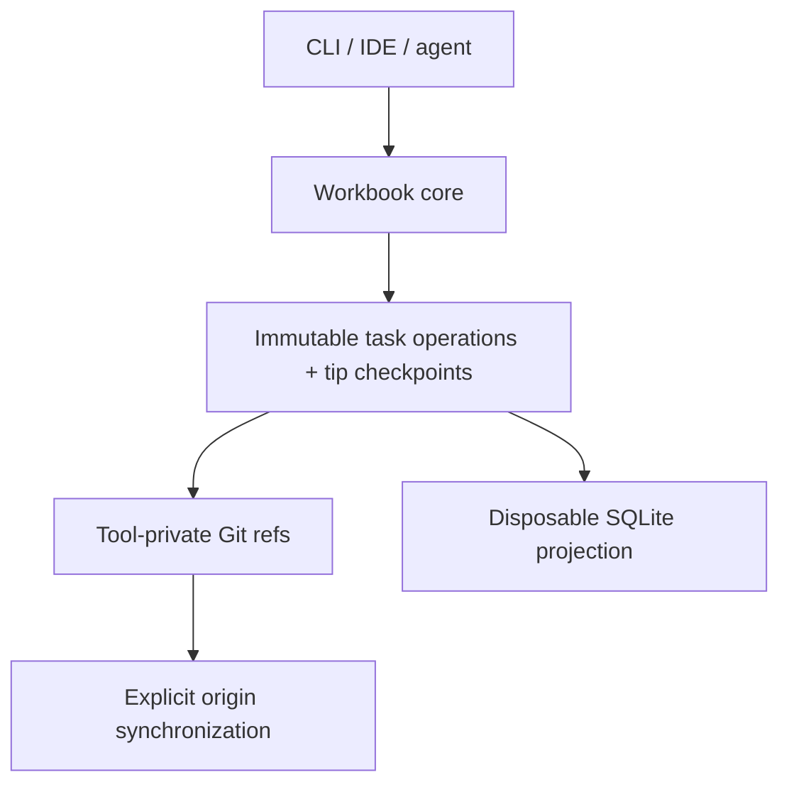

# Workbook architecture

How Workbook stores tasks in Git, keeps replicas synchronized, and projects
state into SQLite. For the command surface, see
[reference.md](reference.md).


Workbook separates its data model, transport, and query engine:



| Layer | Responsibility |
| --- | --- |
| Operation model | Defines task history, current tip checkpoints, causality, and validation |
| Git refs and objects | Store task operations durably and explicitly synchronize task refs with `origin` |
| SQLite projection | Materializes current task state and recorded operations for local reads; Git remains canonical |
| CLI/core library | Currently owns initialization, local validation, CRUD, and user-facing output |
| Optional adapters (proposed) | IDE integrations, local API, MCP, or a coordination relay |

Workbook adds only tracked bootstrap configuration to the working tree. Task state
does not live on the currently checked-out code branch.

## Git storage model

Each task owns a custom Git ref:

```text
refs/workbook/tasks/TASK-123
refs/workbook/tasks/TASK-456
```

The ref points to a Git **commit object**. That commit is the current head of the task's operation DAG:

```text
ref
 └── commit
      ├── parent commit(s)
      └── tree
           ├── operation.json blob
           ├── state.json blob
           └── attachment-<ULID> blob   (only on a commit that attached a file)
```

- A task's root commit has no parents and holds `task.create`, or
  `history.checkpoint` once the task is compacted (see [Compaction](#compaction)).
- A normal edit commit has one parent.
- A future reconciliation or resolution commit can have multiple parents.
- Immutable `operation.json` packs are the authoritative record of task intent,
  and Git parent ancestry is the authoritative record of causality.
- Every commit tree contains the edit's versioned operation pack in
  `operation.json` and a deterministic, durable task materialization in
  `state.json`. A commit that attached a file also carries that file's bytes as
  a blob named for the attachment, and the checkpoint records the blob's object
  ID so reading an attachment costs one object read rather than a tree walk.
- An attachment's bytes are reachable **only** through their own task's ref
  history. There is no shared attachment store and no cross-task deduplication:
  two tasks attaching identical bytes each carry the blob in their own commit,
  and Git storing one object for both is a property of content addressing rather
  than a dependency between the two histories. `workbook compact` depends on
  this: it can drop one task's attachments by replacing that task's history with
  a checkpoint, without reasoning about any other task.
- Removing an attachment hides it and reclaims nothing. The bytes stay in the
  commit that added them, because no command changes a commit. Space comes back
  only after `workbook compact` moves the task's ref to a checkpoint that does
  not carry the bytes, and Git then prunes the commits that are no longer
  reachable.
- The durable model requires each `state.json` checkpoint to match the result of
  applying that commit's operation pack to its parent state, or to no parent
  state for a root commit.
- Ordinary `list`, `show`, `fetch`, and `sync` validate and use current tip
  checkpoints without replaying the complete history. This bounded default does
  not change the authority of immutable operations or Git ancestry.
- Reading a task's operation history — for the projection's `operations` table
  and for `workbook show --history` — reads the operation packs alone and does
  not revalidate their documents, tree shape, or stored checkpoints. The write
  path already prevents this clone from recording an invalid commit, and setup,
  sync, and fetch validate what arrives from elsewhere, so revalidating a whole
  history on every read buys nothing and makes a read scale with history depth.
  An unreadable commit truncates the read softly: the valid prefix is returned
  and the boundary commit is named.
- `workbook validate` explicitly replays history and reconstructs checkpoints;
  it is not part of ordinary current-tip reads or synchronization, and it
  remains the path that audits stored checkpoints.

Using one ref per task avoids a single global state-branch bottleneck: local
commands working on different tasks update different refs. Future concurrent edits
to the same task can form branches in that task's operation DAG and will require
the proposed domain reconciliation rules.

### Operation pack

Each task mutation creates one versioned operation pack. A pack can hold multiple
operations that should be applied atomically:

```json
{
  "format": "workbook.operation-pack",
  "version": 1,
  "projectId": "01K0M65GBZ8F5ZQX0VC1J8H3TP",
  "taskId": "WB-01K0M6B8A4FTT8C39MXXYTW7C1",
  "historyGeneration": "01K0M6B8A4FTT8C39MXXYTW7C2",
  "actor": {
    "id": "agent-7"
  },
  "logicalClock": 2,
  "wallTime": "2026-07-22T14:35:00-04:00",
  "operations": [
    {
      "id": "01K0M6B8A4FTT8C39MXXYTW7C3",
      "type": "field.set",
      "field": "status",
      "value": "ready"
    }
  ]
}
```

The `actor` is the person the edit is recorded under. It is the checkout's Git
`user.email` unless `WORKBOOK_ACTOR` names somebody else. In code the override
travels on the operation's `context.Context` (`core.WithActor`) rather than on
the repository handle or the service. Everything that decides or records by
identity resolves the person from that context first and from the checkout only
when the context names nobody (`core.Service.ActorFor`): the pack's actor, the
assignee `self`, the creator an assignment records, who may remove an
assignment, who may edit a comment, which tasks `next` skips, and the board's
answers about which assignments are the reader's, which they may remove, and
which comments they may edit. So one long-running
process can serve each request as its own person by putting that person on the
request's context, and nothing else. A pack written for a context that names a
different person is refused rather than recorded.

The commit holding a pack takes its author and committer from the pack's own
actor, never from the process writing it. When nobody named the person — the
context asserts no actor, so the actor is the checkout's own `user.email` — the
commit is the one Git writes from the checkout's configuration, exactly as
before the override existed. A replay asserts nobody of its own, so a replayed
pack whose actor is the checkout's `user.email` is written that way too. Any
other actor, and a named one even when it is the checkout's own address,
becomes both author and committer, with the email as the display name too:

```text
operation.json   "actor": {"id": "sam@example.com"}
commit           author    sam@example.com <sam@example.com>
                 committer sam@example.com <sam@example.com>
```

The rule holds for every commit that carries a pack: a first write, a replay of
a task's or the configuration ledger's pack onto a fetched tip, a replay onto a
compaction checkpoint, and the checkpoint itself. A replay is written by
synchronization, which in a hosting process acts for nobody, so taking the name
from the pack is what lets one background sync replay several people's edits,
each under its own name, in a folder with no Git identity at all. An actor Git
would not store byte for byte (it drops `<` and `>`, trims some characters from
the ends, and stores bytes where the pack's JSON cannot hold invalid UTF-8) is
refused for a first write. A replay is never refused for it, because the name
is already in history and nobody can change it: the replayed commit takes the
author and committer recorded on the commit it replays instead. Either way the
actor is asserted, not verified; see [the assignment value](#assignments)
below.

Operation IDs are globally unique and independent of Git object IDs. Git commit ancestry provides causal ordering; a logical clock assists validation and deterministic presentation. Wall-clock time is for display only and must not decide semantic conflicts.

The format supports task creation, scalar and label updates, dependency edges,
tombstones and restores, and assignments. Later CLI and format work is expected
to add:

- `comment.add`;
- `implementation.link` for associating work with code commits.

The lease-and-claim operations this section used to list — `claim.acquire`,
`claim.release`, and heartbeats — were dropped rather than deferred. See
[Assignments](#assignments): a lock asks for the one thing a distributed,
append-only history resists, and the convergent collection it does resist
nothing at all turned out to be the better answer to the same problem.

Historical operation commits are immutable. Tasks are tombstoned rather than
deleting their refs. Shared task histories are never rebased, and Workbook never
force-pushes a ref unconditionally. A clone that diverged from `origin` replays
its own unpublished operations onto the fetched tip and parks the tip it
replaced, which changes only local refs and appends to the shared history.

The one visible, manual exception to moving a task ref only forward is
`workbook compact`. It still changes no commit: it adds one new parentless
checkpoint commit and moves the ref to it, leaving the old commits intact but
unreachable. See [Compaction](#compaction).

### Assignments

An assignment says who is responsible for a task. It is a convergent
collection, exactly like labels: `assign.add` and `assign.remove` operations on
the task, concurrent additions from two clones both surviving, and no conflict
type of its own.

That is deliberate, and it is the answer to a problem a lock cannot solve here.
Two agents working a queue in parallel will sometimes pick the same task. Under
a lease, they fight: each takes the lock, each loses it, and the loop has no
terminating state. Under a collection, they stop instantly in the both-assigned
state — which is a spike, a legitimate working mode, and a thing a person can
read off the board and act on. Assignment signals responsibility, never strongly
blocks, and is always overrideable by addition.

**The value.** An assignment names a *principal* — the asserted Git identity,
`user.email`, already stamped on every operation — optionally qualified by a
free-form *agent label*:

```
dylan@example.com
dylan@example.com/impl-1
```

There is no roster and no verification protocol; verifying identity would import
the central authority Workbook deliberately lacks, and within its trust model
(push access is trust) an asserted identity is exactly as strong as everything
else in a fetched ref. A wrong address is visible noise, corrected socially.
The asserted name need not be the checkout's own: `WORKBOOK_ACTOR` lets a
hosting process record an edit under the person it is acting for, and that name
is exactly as asserted as `user.email`. Whoever can set it can already push.

**What is stored.** The checkpoint materializes the live list, ordered by
principal and then label so that every clone folding the same history writes the
same bytes. The member is omitted when the list is empty, which is what leaves
every task document ever written unchanged:

```json
"assignments": [
  {
    "principal": "dylan@example.com",
    "label": "impl-1",
    "creator": "sam@example.com",
    "createdAt": "2026-08-13T14:35:00-04:00"
  }
]
```

`creator` and `createdAt` come from the pack that recorded the assignment. They
are stored rather than derived because they are the removal rule's evidence, and
that evidence has to live in the history every clone folds.

**The removal rule.** An assignment may be removed only by its
assignee-principal — any actor whose email matches, whatever agent label the
assignment carries — or by the actor who recorded it. The first clause lets an
orchestrator sweep up after its own fleet, including agents that crashed; the
second lets a mistaken tag of a teammate be undone by whoever made it.

It is enforced twice, and the second time is the one that matters:

- **At the mutation boundary**, a foreign removal is refused with category
  `validation` (exit `5`) and a message naming who may make it. Nothing is
  written.
- **In the fold**, `Apply` treats a foreign removal as a recorded no-op: the
  operation stays in the history, attributed to whoever wrote it, and changes
  nothing. This is what makes the rule a data-model contract rather than a
  courtesy of one code path. A pack built with `git hash-object`, written by a
  modified build, or pushed by a peer running something that is not Workbook at
  all folds to the same task on every honest reader.

The fold decides from the pack's actor and the assignment's own recorded
principal and creator, and from nothing else — no local identity, no clock, no
configuration. A no-op rather than a refusal, because refusing would make one
hostile pack a permanent `corrupt-data` verdict on a ref every clone has already
fetched, which is a denial of service dressed as strictness.

Adding an assignment that already exists is idempotent, and keeps the original
attribution, so a redelivered pack cannot rewrite who assigned whom. Removing
one that is not there is refused at the boundary — where it is a mistake
somebody can fix — and tolerated in replay, where it is already history.

**Ceilings.** A principal is bounded at 254 bytes (the longest deliverable
address) and a label at 100. How *many* assignments a task may carry is checked
only where somebody is adding one, never in the fold: two people assigning
themselves the same task on the same afternoon can carry it past any count
without either operation being anything but ordinary, and a fold that failed on
a count would make that pair of acts a task no clone could ever read again.

### Comments

A comment is `comment.add`, `comment.edit` and `comment.remove` operations on
the task, and the checkpoint materializes the live thread. A comment's
identifier is the ULID of the `comment.add` that recorded it, its `author` is
that pack's actor, and `createdAt` and `editedAt` are the wall times of the
packs that added it and last edited it.

**Who may change what.** Only a comment's author may change its text: the
acting person (`core.Service.ActorFor`) must equal the comment's recorded
`author`, exactly. Anybody may remove a comment. Both are asserted names, like
every other identity here.

**Enforced where an edit is authored, and nowhere else.** A foreign edit is
refused at the mutation boundary with category `validation`, and nothing is
written, on the command line and on the board alike. Unlike the assignment
removal rule, the fold deliberately does not enforce it a second time:

- Builds before this rule let anybody edit any comment, so existing histories
  already hold such edits. A fold that dropped them would change what a thread
  already says on every clone that upgraded, and an upgraded clone and an older
  one would fold the same history to different tasks.
- An older build can still record one. A no-op in the new fold would silently
  throw away words somebody wrote, which the concurrency rules forbid.

So `Apply` treats every `comment.edit` exactly as it always has: an edit of a
live comment replaces its body and stamps `editedAt`, whoever recorded it, and
an edit of a comment that is gone changes nothing. Every clone folds the same
history to the same thread, whichever build wrote it. No operation type, no
serialization and no format generation changed.

**What the thread shows about its history.** The checkpoint holds only the live
thread, but the operations already record who removed a comment and who made
each edit: the actor and wall time of the pack that carried them. Readers
derive both from the task's chain on every read (`core.TraceComments`) and
store nothing new:

```text
C1  comment.add     actor bob    id 01K7…A1   "first take"
C2  comment.edit    actor alice  01K7…A1      "alice's words"   ← an older build
C3  comment.remove  actor alice  01K7…A1

thread at C2:  01K7…A1 · bob · "alice's words" · edited by alice
thread at C3:  01K7…A1 · bob · removed by alice at C3's wall time (no text)
```

The derivation mirrors the fold. A removal counts only when it took a live
comment out of the thread, so a second removal of the same comment does not
rename the remover, and an edit counts only when the comment was live to
receive it. The latest edit's actor is named only when its wall time is the
`editedAt` the checkpoint records. A root `history.checkpoint` starts the
derivation afresh, because a compacted task's earlier operations are no longer
on its chain: its thread names nobody for a removal or an edit made before the
compaction.

Two clones racing an edit and a removal of the same comment converge on the
removal in either order. If the removal reaches `origin` first, the edit
replays onto a task whose comment is gone, changes nothing, and so records no
commit; the clone that made it keeps its pre-replay tip parked under
`refs/workbook/reconciled/` for a while, as every reconciliation does. If the
edit reaches `origin` first, the removal replays after it and both stay in
history.

The SQLite projection is unchanged. The operation rows it already keeps for
`show --history` are what the derivation reads, so an existing cache serves it
with nothing to rebuild.

### Mixed Workbook versions

A team does not upgrade all at once, and a task ref is shared history: the
newest clone's writes reach the oldest clone's fetch immediately. From v0.5.0
on, Workbook distinguishes *this history was written by a newer Workbook* from
*this history is corrupt*, because the two need opposite responses — one is
fixed by upgrading, the other by repairing a repository.

**The marker.** An operation pack — a task pack or a configuration-ledger pack —
may carry an optional integer member, `minReader`, naming the lowest
writer-format generation that can fold it:

```json
{"format":"workbook.operation-pack","version":1,"minReader":1, …}
```

Absence means generation 0, and the member is set **per operation type** rather
than per release:

| Generation | Operations |
| --- | --- |
| 0 | `task.create`, `field.set`, `set.add`, `set.remove`, `task.tombstone`, `task.restore` |
| 1 | `assign.add`, `assign.remove`, `comment.add`, `comment.edit`, `comment.remove`, `attachment.add`, `attachment.remove` |
| 2 | `display.set`, `display.unset` |
| 3 | `priority.add`, `priority.rename`, `priority.relabel`, `priority.remove`, `priority.reorder`, `priority.tag`, `priority.untag`, `priority.recolor`, `key.add`, `key.current`, `key.retire` |
| 4 | `history.checkpoint` |

Generation 0 is every operation type Workbook shipped before assignments, and it
is the only generation that writes no marker. So a create, a field change, a
label, a dependency, a tombstone and a restore all still write nothing: every
document written before generation 1 existed — and every document written after
it by a command that neither assigns nor comments — is unchanged, byte for byte,
and golden tables covering every verb assert exactly that. Setting the member
per operation type is what keeps an older clone folding everything it genuinely
can: a task goes out of its reach at the commit that assigns, comments on, or
attaches to it, and not before.

The task and configuration checkpoints beside the packs carry the same member,
as a running maximum over the history so far. That is what lets a reader answer
"can I fold this task at all?" from one object rather than a walk of the chain.

**What an older clone does with one.** Scoped to the one task, or the one
configuration ledger, that carries it:

- **Reads work.** `list`, `board`, `show`, `next` and the web board serve the
  task from its stored checkpoint, which is where every read gets a task from
  anyway. The projected task carries `newerWriter: true`, and the CLI prints a
  non-fatal advisory beside the answer.
- **Mutations are refused**, with category `newer-writer` (exit `9`) and a
  message naming the task and saying to upgrade Workbook. Configuration changes
  are refused the same way when the ledger carries the marker; resolving a
  status against it still works, so boards still have columns and tasks can
  still be filed under statuses that already exist.
- **`workbook validate`** reports it as `newer-writer`, per task, and never as
  `corrupt-data`. It exits `9` rather than `0`: `validate` answers whether this
  clone can vouch for its history, and for these tasks it could not check. If a
  task is *also* genuinely corrupt, corruption is reported first — it is the
  more serious claim.
- **Synchronization never wedges.** Refs advance, other tasks are unaffected,
  and a clone with nothing local on the task simply fast-forwards onto the newer
  tip.

**Every project this build creates starts marked.** A configuration ledger opens
with a `config.genesis` that records the project's statuses and its priorities,
and a genesis carrying a priorities section has to carry the marker as well: a
build that has never heard of that section does not ignore it and fall back to
its own defaults, it refuses the checkpoint outright, so an unmarked genesis
would tell that build the project is corrupt rather than out of date. The
refusals above therefore apply to every project created from this release
onward, from its first commit, before anyone runs a `config` or `priority`
command at all — a v0.5.0 clone reads such a project and synchronizes it, and is
told to upgrade the moment it tries to rename a status. That is a deliberate
trade: Workbook is built for teams working closely together on one project, so
when one of them upgrades, all of them do.

**A project's keys are in that same ledger, and nothing seeds them.** The
statuses and the priorities are written into the genesis; the key set is not,
because a project's founding key already lives in its identity ref and a second
copy in the checkpoint would be a second place for the same fact to be wrong.
The fold reads a ledger with no key section as "the founding key alone, active
and current", and the first `key.add` records that key explicitly ahead of the
change itself, so the recorded order starts where the project's existing task
IDs already do. Which task IDs are this project's is then decided by that set
rather than by the identity record, which is why a fetch applies the
configuration ref before it classifies task refs: a push that delivers a new key
and the first task minted under it has to arrive as one fetch. A `key.*`
operation carries generation 3, like a priority operation, so a project that
adds a key is in exactly the position the paragraph above describes. A clone
released before keys existed reads such a checkpoint the way it reads any
newer-generation one — leniently, dropping the section it has no field for
rather than refusing it, so the project still has statuses and columns — and
then decides what a task ref is against the key in the identity record alone.
That project's newest tasks therefore read to it as another project's refs,
which is the signal to upgrade rather than a judgment about the refs.

**Divergence is the hard edge**, and the answer is deliberate. If a clone has
unpublished operations on a task whose `origin` history has since gained a
newer-generation pack, replay is impossible by definition: the local operations
would have to be folded onto a checkpoint whose rules this build does not have.
Workbook **refuses the replay and changes nothing**. The task's ref is left
exactly where it is, holding every local operation; `origin`'s tip waits in the
tracking namespace; the task is reported as `needs-upgrade` and the run exits
`9`. That task is also not pushed, because `origin` already holds a tip the
local ref is not a descendant of and the push could only be rejected. Nothing is
parked, because nothing was replaced, and nothing is lost — the operations
publish themselves on the first sync after the upgrade. The configuration ledger
behaves identically.

**An unknown operation type with no marker is still `corrupt-data`.** That is
the whole point of the marker: without one, a type nobody recognizes is
tampering or a bug, not a version skew, and telling somebody to upgrade their
way out of a broken ref would be wrong. A marker at or below the reader's
generation changes nothing at all.

**The commit's tree is judged by the same rule, and after the marker.** A
generation may add entries to a commit tree — generation 1 did, for attachment
blobs — so tree shape is checked only once the pack beside it has been decoded,
and skipped entirely when the pack declares a generation the reader cannot fold.
What holds at every generation is that `operation.json` and `state.json` are
there as regular blobs, because a reader that cannot find the checkpoint cannot
serve the task at all. An entry a reader does not recognize *at its own
generation* is still `corrupt-data`; one under a newer marker is simply not that
reader's to judge. Checking it any earlier would have put a wall in front of the
next format change in the very place the marker exists to remove one.

**Before v0.5.0 there is no signal**, and honesty about what that costs matters
more than the reassurance. Installed binaries are frozen; v0.4.4 and earlier
predate the marker entirely, and their behavior against a newer pack is whatever
it is. The measured record from the PR #95 review is two different failures:
a pack using a custom status blocks the ref at fetch time, permanently, and
keeps stale data until the clone is upgraded; a restore-with-destination pack
reads, synchronizes and mutates fine but fails `workbook validate` for that one
task, permanently, as `corrupt-data`. Neither is repairable from the newer side,
because the history is already written and append-only. v0.5.0 is the last
release that can carry this hard edge, which is why the signal ships in it.

The marker is a claim made by whoever wrote the pack, and it is trusted for the
same reason every other field in a fetched ref is: anyone with push access can
already write a ref this clone refuses. What the marker changes is which message
that produces, not who is trusted.

### Compaction

Every commit on a task's ref carries a full `state.json`, so a task's history
only grows, and every attachment ever added stays in it. `workbook compact`
lets a team drop the step-by-step history of Done and Deleted tasks when it
decides to. Workbook never compacts on its own. The command, its flags and its
output are in [reference.md](reference.md#task-archive-compaction); this
section covers what it does to the storage model.

**What a run writes.** For each task it compacts, one parentless *checkpoint
commit* (the checkpoint, below), whose tree holds:

- `operation.json`: a pack holding one `history.checkpoint` operation. It
  carries the complete task value, so it folds with no prior history, and a
  summary of what it replaced: the run ID, `compactedFrom` (the object ID of the
  tip it replaced), the previous history generation, how many commits it
  replaced and the wall times of the first and last of them, when the task last
  became Done and last became Deleted, whether attachments were `kept` or
  `dropped`, and the ID of every operation it replaces. A task compacted a second
  time lists the operations of both runs.
- `state.json`: the task's current state. `history.generation` is a new ULID,
  `history.compactedFrom` names the replaced tip, and the logical clock carries
  on from the old tip rather than restarting.
- `attachment-<ULID>` blobs, only with `--keep-attachments`. Without it, each
  file attachment stays in `state.json` as an entry marked `dropped` with the run
  ID and time, and its bytes are left behind with the old history. Links store
  no bytes and are kept unchanged.

Title, description, status, labels, priority, rank, dependencies, comments and
assignments all live in `state.json` and survive unchanged. The task stays fully
editable: the next change is an ordinary single-parent commit on top of the
checkpoint, in the new generation.

Before and after compacting one Done task, with a later edit:

```text
before                                after
refs/workbook/tasks/WB-01K…           refs/workbook/tasks/WB-01K…
 └── C3  field.set status=done         └── E1  field.set status=ready     (history generation G2)
      └── C2  comment.add                   └── K   history.checkpoint    (history generation G2, no parent)
           └── C1  task.create                       state.json: compactedFrom = C3
                   (history generation G1)            lists the operations of C1, C2, C3

                                      C3 ── C2 ── C1   unchanged, reachable from no ref,
                                                       saved first in
                                                       <git-common-dir>/workbook-archive/<run-id>.bundle
```

No commit is changed, rebased or deleted. The run adds `K`, and moves the ref
from `C3` to `K` with a compare-and-swap on `C3`; a task whose ref moved since
it was read is skipped. The same transaction deletes the task's parked refs
under `refs/workbook/reconciled/<id>/`, and the run then expires the task's
reflog, so nothing Workbook keeps holds the old history. The commits stay in the
object store, unreachable, until `git gc` prunes them.

**The backup bundle.** Before it moves any ref, a run writes a Git bundle of
everything it is about to make unreachable: each task's old tip under
`refs/workbook/tasks/<id>`, its parked refs under their own names, and a
manifest commit at `refs/workbook/archive/manifest` whose `manifest.json`
(`workbook.archive-manifest`, version 1) names the project, the run, the flags,
and for each task its title, old tip, old and new generation and commit count.
The histories are self-contained, so the bundle has no prerequisites. It is
checked with `git bundle verify`, and a failure changes nothing. Workbook never
reads, rotates or deletes a bundle. `compactedFrom` is what links a checkpoint
to the bundle holding its history, by content rather than by file name.

**Publishing is a leased non-fast-forward.** Git treats any ref move that does
not build on the old tip as a forced update, so `K` cannot be pushed as a fast
forward. The push names the ref in a plain refspec (no `+`, because a `+`
refspec makes Git ignore the lease) and adds
`--force-with-lease=refs/workbook/tasks/<id>:<expected>`. The expected value is
origin's tip as this clone last fetched it, and the lease is offered only once
this clone has shown that it accounts for every operation there: each one is in
the checkpoint's list or on the local chain above it. `C3` itself is the simple
case. If origin moved on after the compaction, the next fetch replays origin's
new operations onto `K` and the lease names origin's newer tip. Origin accepts
the push only while it still holds exactly that tip; otherwise Git refuses it
without touching origin. After origin accepts it, the clone moves its tracking
ref to `K` as well, because a stale tracking ref would keep the old history
reachable. Git's own `receive.denyNonFastForwards` covers only `refs/heads/*`,
so it does not block this push. A host that refuses non-fast-forward updates to
Workbook refs some other way, such as a server-side hook or ruleset, rejects
it, and the checkpoint stays local.

**Other clones adopt it during fetch.** When a fetch finds origin's tip is a
checkpoint in a generation the clone does not have:

- If every local operation is in the checkpoint's list or already on origin,
  the local ref moves to the checkpoint.
- Otherwise the local-only operations, those neither in the list nor on origin
  since the checkpoint, are replayed onto it as ordinary single-parent commits
  in the new generation, keeping their actor, wall time and operation IDs. This
  does not need `compactedFrom` to be present locally.
- Unlike an ordinary reconcile, the old local tip is not parked, since parking
  it would keep the history alive. The task's existing parked refs and reflog
  are dropped too, without a bundle.
- When two clones compact the same task, origin's checkpoint wins, and the
  second clone adopts it the same way.
- When the replay cannot run cleanly, the local ref stays on the old history and
  the task is withheld from every push until `workbook compact --adopt`
  settles it.

The projection's head-advance guard accepts a generation change only when the
new tip is rooted at a valid checkpoint that accounts for every operation on the
head the projection last saw. Any other generation change is still a rewrite.
`workbook validate` treats a checkpoint as a root: `state.json` must be what the
`history.checkpoint` operation folds to, with no prior state, and none of the
discarded history is needed.

**Older clones.** A checkpoint and every state after it declare generation 4.
v0.6.1, the last release before compaction, does not get as far as the
newer-writer refusal above for a task it already holds. Its fetch force-moves
the tracking ref to the checkpoint, and every sync then fails, reporting
"tracking and canonical tips use different history generations" as if the data
were invalid. The local ref stays on the old history, so v0.6.1 keeps accepting
edits to the task that can never be pushed, and with the managed pre-push hook
installed every code push from that clone fails too. It never pushes the old
history over the checkpoint, so nothing is lost, but the message is wrong and
the hook blocks unrelated work. That is why every clone has to upgrade before
anyone compacts. From this release on, a checkpoint from a later generation
than the reader's is handled by the marker like any other newer-writer history.

## Concurrency and synchronization

Explicit synchronization, a combined fetch-then-push sync command, and
replay-based reconciliation of divergent task histories are implemented. The
model is:

1. Fetch the relevant Workbook ref.
2. Replay any local-only operation packs onto the fetched tip.
3. Validate the requested transition against the projected task.
4. Write an operation pack and Git commit.
5. Atomically advance the local task ref.
6. Push that task ref.
7. If the remote changed concurrently, the next fetch replays onto its new tip.

Most operations converge because they touch different fields. Meaningful
contradictions are surfaced rather than silently hidden, through the three
conflicts described in
[Reconciling divergent histories](reference.md#reconciling-divergent-histories). Concurrent
`done` and `in-review` status changes are not among them: status is
last-syncer-wins, and multi-value status conflicts remain proposed.

Exclusive claims are different. When `--remote-required` is used, a claim succeeds only after the remote accepts a fast-forward update based on the task ref that was fetched. If another agent claimed the task first, Workbook refetches and reports that the claim failed instead of merging two exclusive claims. Offline claims, if supported, must be visibly tentative.

Workbook does not rely on Git hooks for correctness. The optional managed
pre-push hook publishes task refs as a convenience, but fresh clones, alternate
Git clients, and remote PR merges cannot be assumed to execute it.

## Relationship to code branches

Implementation links and landed-state reporting are proposed; the current POC
does not implement them. The intended model keeps workflow state and code
availability as separate facts.

A task operation can record an implementation commit, while Workbook computes whether that implementation is reachable from the current branch or the configured target branch. This supports states such as:

- implemented on a feature branch but not landed;
- landed on `main`;
- done globally but absent from the currently checked-out historical branch.

Commit trailers provide a stable link across squash merges and cherry-picks:

```text
Task: TASK-123
```

Facts Git can derive, such as whether work has landed on `main`, should not be duplicated as mutable tracker state.

## SQLite projection

SQLite is a local, disposable read cache, never the canonical source of truth.
The shared cache is stored at `<git-common-dir>/workbook/cache.sqlite`, so linked
worktrees use the same projection. It materializes current task state, including
labels and dependencies; direct SQL writes and arbitrary SQL query support are not
part of the Workbook interface.

Before normal task reads (`list`, `show`, `board`, `next`, and web `GET
/api/tasks`), Workbook validates the cache against current Git task heads and
refreshes changed checkpoints. Create, update, and other mutations continue to
write Git operations directly. Run `workbook rebuild` to explicitly recreate the
cache; it builds a temporary database, checks task heads again, retries once if
they changed during the build, and atomically installs a stable result. With
`--json`, the normal result envelope contains `taskCount` and `cachePath`.

An `operations` table alongside the task tables materializes each task's recorded
operations for `workbook show --history`, `--compare`, and web
`GET /api/tasks/<id>/history`. Its rows are keyed on
the operation ULID rather than the commit object ID, because replay preserves
operation ULIDs while rewriting logical clocks and therefore every downstream
object ID; a surviving row changes only its ordering and object-ID columns. Rows
hold operations alone, with no per-row state checkpoint: any state is
reconstructed by replaying from the root.

Because comparing tips is complete for current state but blind to intermediate
commits — a fetch advancing a task twelve commits yields one new tip and eleven
unread packs — refresh walks each changed task from the head the projection
already holds to its new one, and a rebuild reprojects full histories. A new head
that does not descend from the projected one is the reconciliation signal: replay
drops operations three ways, so upserting alone would strand rows and break the
logical-clock chain a root-first replay depends on. Workbook deletes that task's
operation rows and reprojects the returned chain instead. Refresh and rebuild
therefore scale with operation count rather than task count, as the
projection-refresh benchmark family measures.

The cache can be deleted at any time and rebuilt entirely from Workbook refs.
Semantic validation results live in a separate `validation.sqlite` beside it, so
a validator-version bump does not force a projection rebuild and a long
validation pass does not hold the projection's writer lock against mutations.

## Bootstrap and portability

A normal Git clone does not fetch arbitrary custom ref namespaces, so bootstrap
stays explicit. Installing Workbook is a separate step: `brew install
dgoings/tap/workbook`, or `./scripts/install.sh` to build from source.

`workbook setup` then performs the repository half of the bootstrap:

1. detect the repository and validate Git identity;
2. resolve the project identity — adopt `origin`'s `refs/workbook/project` if it
   publishes one, otherwise the identity ref, tracked configuration or private
   guard this checkout already has, and only then mint a new one, asking for the
   project key on a terminal and deriving it from the directory name otherwise —
   publishing `refs/workbook/project` and writing `.workbook/config.json` when it
   is absent. The key minted here is the project's founding key, which seeds its
   key set: the configuration ledger can add keys and move which one new tasks
   are minted under, and this is the one the set starts from;
3. repair or write the private common-directory guard from that identity;
4. write the user-global configuration file when it is missing;
5. install or refresh managed agent documentation and the project-local Workbook skill;
6. explicitly fetch and publish `refs/workbook/project` and `refs/workbook/tasks/*`
   through `origin`, or report that synchronization was skipped when no remote is
   configured;
7. report which record the identity came from, and the resulting task count.

Setup deliberately does not install Git hooks. Hooks remain opt-in through
`workbook hooks install`, because they must never be required for correctness.

`workbook setup --tasks-only <url>` is the same bootstrap for a folder that holds
a project's tasks and none of its code, such as a server running the web board.
It makes an empty folder an ordinary non-bare Git folder with nothing checked
out, and records that it is tasks-only in the folder's own Git settings
(`workbook.tasksOnly = true`) rather than in the shared `.workbook/config.json`.
That setting is about this one copy of the project, not about the project. The
folder's `origin` carries a single negative fetch refspec, `^refs/*`, so a plain
`git fetch` or `git pull` downloads nothing, while Workbook's own fetches name
their refspecs on the command line as they do everywhere else:

```text
tasks-only folder                         origin
  refs/workbook/project          <-----   refs/workbook/project
  refs/workbook/config           <---->   refs/workbook/config
  refs/workbook/tasks/*          <---->   refs/workbook/tasks/*
  (no refs/heads, no refs/tags)      x    refs/heads/*, refs/tags/*  (code)
```

The folder joins only through the published identity ref. Step 2's fallback,
reading `.workbook/config.json` from origin's default branch, would download the
code, so a tasks-only folder skips it. It skips step 5 too, and never mints.
Commands that need code history read the marker and report themselves
unavailable rather than answering from history the folder does not hold.

The default shared backend uses custom refs because they avoid branch switching and per-repository head contention. A conventional `workbook/state` branch may be offered as a compatibility fallback for Git hosts that reject custom refs. A future optional relay may provide strict leases, heartbeats, notifications, or high-concurrency agent coordination while retaining the same operation model.

## Design principles

- **Repository-native:** use the existing Git repository and remote.
- **Local-first:** remain useful offline; synchronize explicitly and transparently.
- **CLI-first:** every capability is available without a GUI or long-running server. A watcher makes synchronization cheaper; it never becomes required.
- **Agent-friendly:** stable semantic commands and machine-readable output minimize context and token use.
- **Human-inspectable:** operation payloads use versioned, inspectable formats.
- **Derived when possible:** do not duplicate facts already represented by Git.
- **No hidden rewrites:** shared history is append-only and never force-pushed
  unconditionally. The one exception, `workbook compact`, is visible and manual,
  and adds a checkpoint commit rather than changing any commit.
- **Progressive complexity:** no service is required for the default workflow; stronger coordination can be optional.

## Non-goals

At least initially, Workbook is not intended to provide:

- a hosted Jira or Linear replacement;
- organization-wide portfolio planning across many repositories;
- real-time collaborative rich-text editing;
- strict distributed leases without an online coordination authority;
- a required MCP server or IDE integration;
- field-level permissions beyond the repository's Git access controls.

